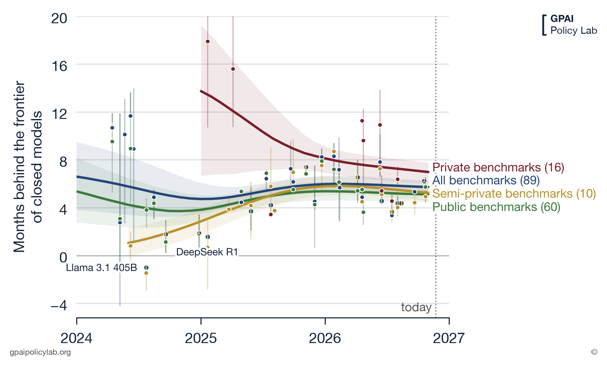
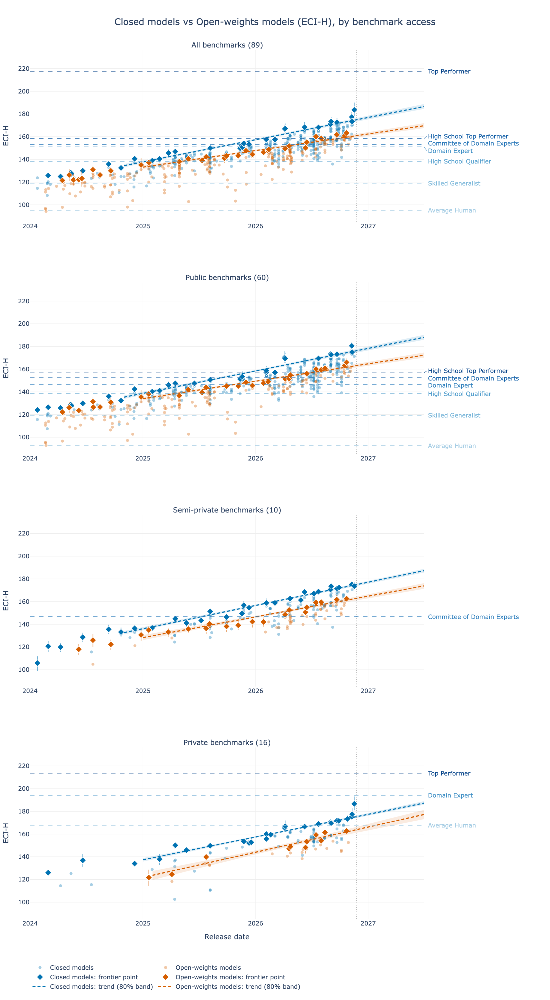

# How far behind the closed frontier are open-weights models? ECI-H by benchmark access

The question of [Ihle (2026), *How far behind are open models?*](https://www.lesswrong.com/posts/rJcCrXyEsJKmmDpWG/how-far-behind-are-open-models), asked on our ECI-H scale instead of per-benchmark score thresholds: how many months does the open-weights frontier trail the closed one, and does the answer change with the access class of the benchmarks?

Data generation 2026-11-18 (pipeline commit `3a654fe`: the feeds refreshed on 2026-11-18, with GDP.pdf v1.1, the Pro and Deep Think parallel-compute models out of the views and the lab's TriviaQA runs; five rate-scored benchmarks scored as items since `fcea240`), today pinned at 2026-11-23, ECI-H on Epoch's anchors (since 2026-11-19, a scale about a fifth tighter than the one of the earlier versions of this note). Figures and tables are copies of `5_outputs/data20261118/comparisons/frontier_gap_openness_*`; French versions in `fr/`. The months-behind figure, English and French, is drawn in the lab's print style (`viz.frontier_gap_print`, vector twins in `svg/` and `fr/svg/`; the `.html` twin is the interactive one): from 2024, axis cut at 20 months (a few intervals run off the top), overlapping record dots drawn as one disc split by colour.



## Results

Months behind the closed frontier over the last twelve months, median [80% interval]:

| | All (89) | Public (60) | Semi-private (10) | Private (16) |
|---|---|---|---|---|
| At the open-weights frontier points (records and runners-up) | 6.0 [5.4, 6.7] | 5.4 [4.7, 6.2] | 5.8 [5.1, 6.6] | 7.4 [6.3, 8.3] |
| On an average day (second-best to second-best) | 6.3 [5.2, 7.1] | 5.9 [4.7, 6.9] | 7.4 [6.6, 8.0] | 10.3 [8.9, 10.8] |

- **About six months.** On all benchmarks the open frontier points of the last year (the records and their runners-up, read against the closed second-best) sit where the closed frontier stood 6.0 months earlier (6.3 on an average day of the year); the trend lines through those points say the same order of magnitude (8.6 [7.5, 9.6] months today, gap over the closed slope). The closed frontier gains 19.6 ECI-H a year against 14.6 for open weights: the gap in points is widening.
- **Private benchmarks show a longer lag**, 1.9 [0.6, 3.1] months more than public benchmarks at the frontier points (two fits on disjoint benchmarks, so an independent comparison), 4.2 [2.7, 5.6] on an average day. This is Ihle's direction (8-10 months private, 4-6 public).
- **Semi-private sits in between** (5.8 months, against 5.4 on public and 7.4 on private; 7.4 on an average day, against 5.9 and 10.3).

The three lags per scope: [`frontier_gap_openness_table.md`](frontier_gap_openness_table.md); every quantity (slopes, gaps in ECI-H) and the differences between scopes, private − public among them, in [`frontier_gap_openness_table.csv`](frontier_gap_openness_table.csv).



## Method

- **Fits.** The canonical K=1 ECI-H fit on its 89 benchmarks (`--human-merge`, 8 x 2,500 draws) and three quick fits (4 x 2,000) on one access class each. The index leaves out, besides the benchmarks built to be easy for humans, the six mainly visual ones (VISTA, GeoBench, BlueprintBench 2, VisualToolBench, EnigmaEval, Furniture Assembly: humans at or above the best models, a few labs' vision models favoured, open models rarely scored); SpireClimb, played through screenshots, stays in like OSWorld (user, 2026-10-20). Classes come from the pipeline: a scored set anyone can download without a human reviewing the request is public (an automatic gate counts), a held-out scored set with a released sample is semi-private (an illustrative example is not a sample), a set never released or given on reviewed request is private. The classes agree with Ihle's on all 17 benchmarks of his post. List: [`frontier_gap_openness_benchmark_classes.md`](frontier_gap_openness_benchmark_classes.md).
- **One scale.** The all-benchmarks fit is pinned by its two anchors (Claude 3.5 Sonnet June 2024 = 130, GPT-5 high = 150, Epoch's). Each class fit is linked onto it through the closed OpenAI, Anthropic and Google models with at least four scores in the class (mean-sigma, per draw): the anchors alone hold as few as two scores in a class, other labs' models may be tuned to some benchmarks, and linking through open models would erase the difference being measured.
- **Open or closed** (`1_curated/model_openness.csv`): open when the weights are downloadable at release or within 30 days (GLM-5.3 open, grok-2 closed), and a hosted version of open weights is open (Qwen3.5-Plus).
- **Records.** Candidates are dated releases with at least two scores in the scope,; a group's frontier is the running maximum of posterior-median ECI-H, one effort per family and one release per day. In a class, an open record only counts if the release is within 5 ECI-H of the open record of its date on all benchmarks (in 2024 the open "records" on private benchmarks were Llama 3.1 8B and Pixtral 12B, the open models that happened to be scored).
- **Months behind.** Per posterior draw, the months between an open record and the first closed model at or above it; the dot is the posterior mean of that lag (the draws take a few values, release date differences, and a median jumps between two of them), its bar the 50% interval. Closed candidates with a posterior SD above 6 ECI-H date no crossing (two-score releases of 2019-2023; PaLM 2-L alone put a year-long tail on the 2024 lags). A level the class's closed models already exceeded when first scored is read off the all-benchmarks closed frontier instead; on all and public benchmarks, where nothing precedes the first well-measured closed model (davinci on both), it is dated back at the closed frontier's early rate and a record that needs this in more than two thirds of draws is dropped. Curves are 6-month Gaussian smooths of the per-draw record lags, the band their 10-90% range across draws. The table's second row reads the same lag month by month from the two per-draw frontiers (the open frontier of the month against the first closed model at or above it, a sawtooth whose minima are the record lags) averaged over the trailing twelve months: the lag on an average day, larger than the record mean when records are sparse. The study behind these choices: [`../us_cn_frontier/investigation_2026-10-20/`](../us_cn_frontier/investigation_2026-10-20/).
- **Trend lines.** One straight line per group through its records since 2024-10-01, each weighted by its posterior SD plus a common dispersion; the lag today is the gap over the closed slope (how long ago the closed line stood where the open line stands).

## Caveats

- Class fits are quick fits (max r̂ ≤ 1.021, at most 2 divergences out of 8,000, on private). Each keeps the two anchors, which have scores in every class (the June 2024 Claude 3.5 Sonnet has two on semi-private and two on private benchmarks).
- Open coverage is thin outside public benchmarks: 31 open candidates on private benchmarks against 112 closed, 11 frontier points.
- Gaps in ECI-H points depend on the linking; lags in months do not (any positive affine map per draw leaves them unchanged).
- The human tiers of a class are placed by the few baselines left in it; on private benchmarks they sit implausibly high, and no number here reads them.
- The frontier accelerates over 2024-2026, so a straight line through the records is a summary, not a model; the record lags are the headline.

## Run

```bash
python 1_curated/3_build_model_openness.py --pipeline ../benchmark-data-pipeline   # after a sync, on the checkout of the synced run
python 3_fit/fit.py --preset canonical --human-merge
python 3_fit/fit.py --preset canonical --access public       --human-merge --chains 4 --draws 2000 --tune 2000
python 3_fit/fit.py --preset canonical --access semi_private --human-merge --chains 4 --draws 2000 --tune 2000
python 3_fit/fit.py --preset canonical --access private      --human-merge --chains 4 --draws 2000 --tune 2000
TODAY=2026-11-23 5_outputs/open_closed_frontier/make_plots.sh
```

The code is `analysis.frontier_gap`, run per scope by `4_diagnostics/1_frontier_gap.py` and put side by side by `4_diagnostics/2_plot_frontier_gap.py`. The records CSVs (`frontier_gap_openness_<scope>_records.csv`) give every open record's lag, the closed models that first beat it and the share of borrowed or dated-back draws.
