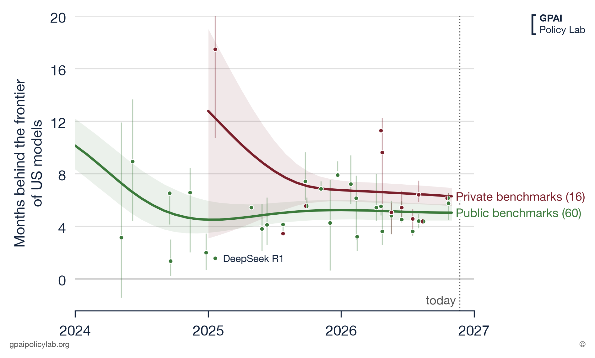
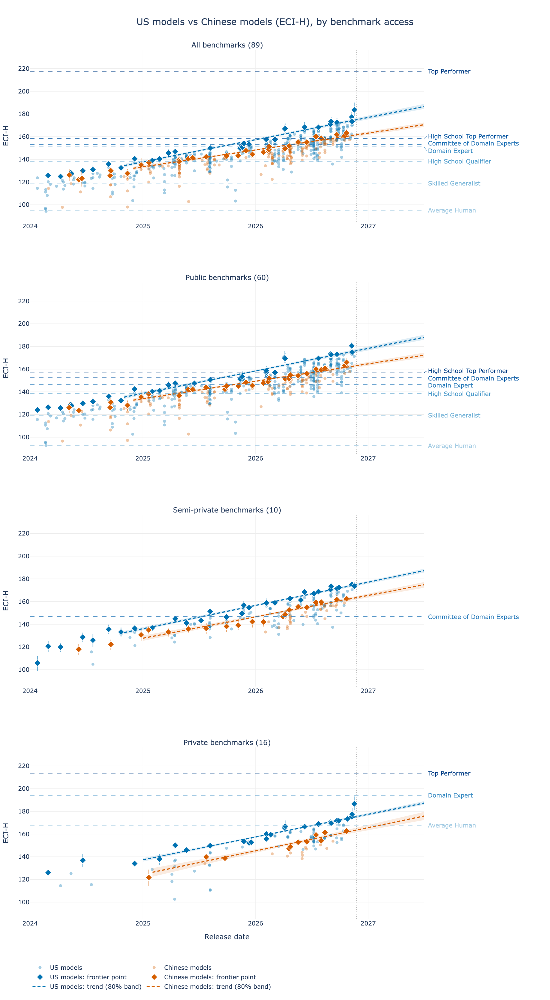

# How far behind the US frontier are Chinese models? ECI-H by benchmark access

How many months the frontier of Chinese models trails the frontier of US models on our ECI-H scale, and whether the answer changes with the access class of the benchmarks. This complements the open-weights vs closed cut of [`../open_closed_frontier/`](../open_closed_frontier/) with the country cut, on the same fits and the same method.

Data generation 2026-11-18 (pipeline commit `3a654fe`: the feeds refreshed on 2026-11-18, with GDP.pdf v1.1, the Pro and Deep Think parallel-compute models out of the views and the lab's TriviaQA runs; five rate-scored benchmarks scored as items since `fcea240`), today pinned at 2026-11-23, ECI-H on Epoch's anchors (since 2026-11-19, a scale about a fifth tighter than the one of the earlier versions of this note). Figures and tables are copies of `5_outputs/data20261118/comparisons/frontier_gap_country_*`; French versions in `fr/`. The months-behind figure, English and French, is drawn in the lab's print style with two curves only, public and private benchmarks (`viz.frontier_gap_print`, vector twins in `svg/` and `fr/svg/`; the `.html` twin is the interactive one): from 2024, axis cut at 20 months (a few intervals run off the top), overlapping record dots drawn as one disc split by colour.



## Results

Months behind the US frontier over the last twelve months, median [80% interval]:

| | All (89) | Public (60) | Semi-private (10) | Private (16) |
|---|---|---|---|---|
| At the Chinese frontier points (records and runners-up) | 5.6 [4.9, 6.3] | 5.2 [4.5, 6.0] | 5.7 [5.0, 6.5] | 6.6 [5.8, 7.3] |
| On an average day (second-best to second-best) | 5.7 [4.7, 6.5] | 5.5 [4.5, 6.4] | 7.1 [6.4, 7.7] | 8.6 [8.0, 9.1] |

- **About five and a half months.** On all benchmarks the Chinese frontier points of the last year (the records and their runners-up, read against the US second-best) sit where the US frontier stood 5.6 months earlier, and the lag on an average day of the year (second row) says the same; the trend lines through those points say the same order of magnitude (8.1 [7.1, 9.1] months today, gap over the US slope). The US frontier gains 19.6 ECI-H a year against 14.9 for Chinese models: the gap in points is widening.
- **Private benchmarks: a longer lag.** 1.4 [0.2, 2.4] months more than public benchmarks at the frontier points (two fits on disjoint benchmarks), an 80% interval now clear of zero (it included it on the 2026-10-19 data), and 3.1 [2.0, 4.3] on an average day. The second reading is larger because the private scope has few Chinese points (11), months apart: the point lags are the minima of the sawtooth the lag draws between them, and the time average counts the months in between. The private reading stays thin (25 Chinese candidates).
- **Semi-private sits between** (5.7 months, against 5.2 on public and 6.6 on private).
- **The same answer as the open-weights cut.** Most Chinese frontier points are open-weights models (Kimi, GLM, DeepSeek, Qwen's and Xiaomi's open series), with a few API-only models among them (3 of the 16 points of the last year: Doubao Seed 2.0 Pro, Qwen3.6-Max preview, Qwen3.7-Max); on the same data the open-weights lag is 6.0 months on all benchmarks.

The three lags per scope: [`frontier_gap_country_table.md`](frontier_gap_country_table.md); every quantity (slopes, gaps in ECI-H) and the differences between scopes in [`frontier_gap_country_table.csv`](frontier_gap_country_table.csv).



## Method

- **Fits.** The canonical K=1 ECI-H fit on its 89 benchmarks (`--human-merge`, 8 x 2,500 draws) and three quick fits (4 x 2,000) on one access class each, the same fits as the open/closed note. The index leaves out the benchmarks built to be easy for humans and the six mainly visual ones (VISTA, GeoBench, BlueprintBench 2, VisualToolBench, EnigmaEval, Furniture Assembly); SpireClimb, played through screenshots, stays in like OSWorld (user, 2026-10-20). Access classes come from the pipeline; list: [`frontier_gap_country_benchmark_classes.md`](frontier_gap_country_benchmark_classes.md).
- **Groups.** A model's country is the pipeline's `country` column (its developer's); models of other countries are left out.
- **One scale.** Each class fit is linked onto the all-benchmarks fit through the US models of OpenAI, Anthropic and Google with at least four scores in the class (mean-sigma, per draw).
- **Records, months behind, trend lines.** As in the open/closed note: running maximum of posterior-median ECI-H per group; per draw, the months between a Chinese record and the first US model at or above it (the dot is the posterior mean of that lag, its bar the 50% interval; US candidates with a posterior SD above 6 ECI-H date no crossing); the curve is a 6-month Gaussian kernel through the per-draw record lags; the same lag month by month from the two per-draw frontiers, averaged over the trailing twelve months, is the table's second row; one straight line per group through its records since 2024-10-01, the lag today being the gap over the US slope. The investigation behind the curve and the dots (2026-10-20): [`investigation_2026-10-20/`](investigation_2026-10-20/).

## Caveats

- Class fits are quick fits (max r̂ ≤ 1.021, at most 2 divergences out of 8,000, on private).
- Chinese coverage is thin outside public benchmarks: 25 Chinese candidates on private benchmarks against 115 US ones, 11 frontier points.
- The uncertainty of a record's lag is mostly the US side's: which US model first beat it, and when. On the 2026-10-01 data, half of the crossing draws of the 2026 records named GPT-5 Pro or GPT-5.2 Pro efforts scored on two or three benchmarks (investigation of 2026-10-20); the Pro line has since left the views (parallel compute, 2026-11-17).
- Gaps in ECI-H points depend on the linking; lags in months do not.
- The frontier accelerates over 2024-2026, so a straight line through the records is a summary, not a model; the record lags are the headline.

## Reproduce

```bash
TODAY=2026-11-23 5_outputs/us_cn_frontier/make_plots.sh
```

It runs the open/closed script with `GROUP=country` (`4_diagnostics/1_frontier_gap.py --group country` on the four scopes, then `2_plot_frontier_gap.py --group country --print-scopes public,private`) and copies the deliverables here.
