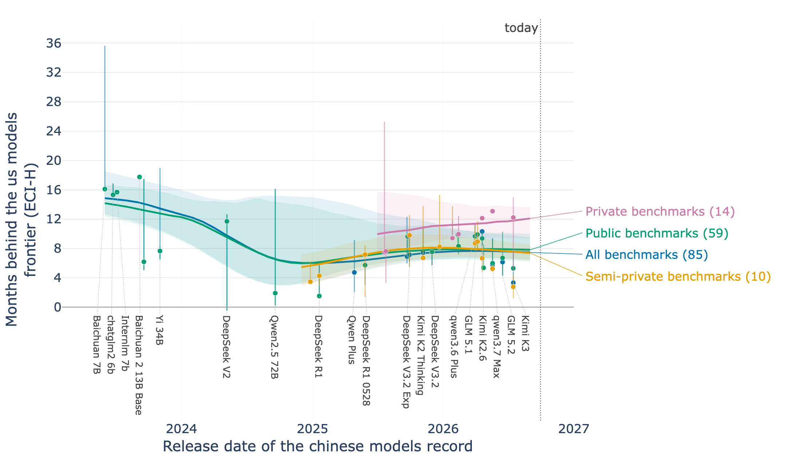
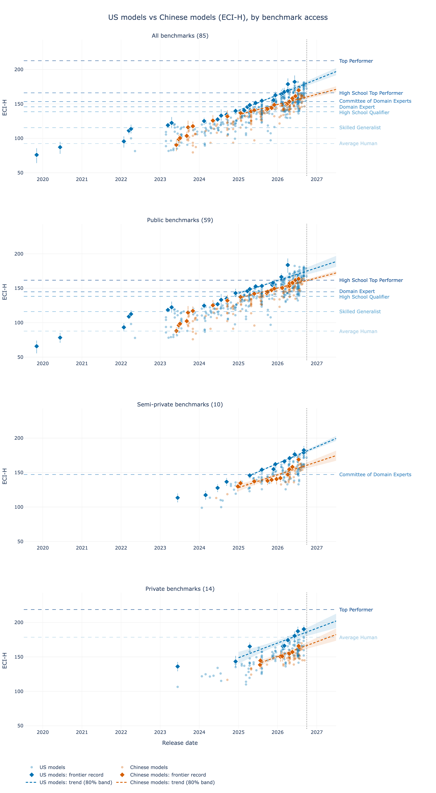

# How far behind the US frontier are Chinese models? ECI-H by benchmark access

How many months the frontier of Chinese models trails the frontier of US models on our ECI-H scale, and whether the answer changes with the access class of the benchmarks. This replaces the open-weights vs closed cut of [`../open_closed_frontier/`](../open_closed_frontier/) (kept as it was on the 2026-09-29 data) with the country cut, on the same fits and the same method.

Data generation 2026-09-30 (pipeline commit `8601d1e`, feeds refreshed on 2026-09-29), today pinned at 2026-09-30. Figures and tables are copies of `5_outputs/data20260930/comparisons/frontier_gap_country_*`; French versions in `fr/`, vector twins in `fr/svg/`. The French months-behind figure is drawn in the lab's print style (`viz.frontier_gap_print`) with two curves only, all benchmarks and private benchmarks, and its axis stops at 24 months (a few early intervals run off the top).



## Results

Chinese records of the last twelve months, median [80% interval]:

| | All (85) | Public (59) | Semi-private (10) | Private (14) |
|---|---|---|---|---|
| Months behind the US frontier | 7.7 [6.7, 10.5] | 8.0 [6.5, 10.5] | 8.1 [6.8, 9.7] | 11.1 [8.9, 14.4] |

- **About eight months.** On all benchmarks the Chinese records of the last year sit where the US frontier stood 7.7 months earlier; the trend lines through the records say the same order of magnitude (10.5 [8.8, 12.0] months today, gap over the US slope). The US frontier gains 22.6 ECI-H a year against 14.7 for Chinese models: the gap in points is widening.
- **Private benchmarks show a longer lag**, 3.0 [-0.3, 6.7] months more than public benchmarks (two fits on disjoint benchmarks), an interval that now touches zero. As in the open/closed cut, most of it rests on o3 (April 2025), the first US model above most 2026 Chinese records on private benchmarks.
- **Semi-private and public agree** (8.1 and 8.0 months).
- **Close to the open-weights answer.** Most Chinese records are open-weights models (Kimi, GLM, DeepSeek, Qwen's open series); the API-only Qwen3.6-Plus, Qwen3.6-Max Preview and Qwen3.7-Max are among them too. On the same data the open-weights lag is 7.4 months on all benchmarks, so the two cuts measure nearly the same frontier.

The three lags per scope: [`frontier_gap_country_table.md`](frontier_gap_country_table.md); every quantity (slopes, gaps in ECI-H) and the differences between scopes in [`frontier_gap_country_table.csv`](frontier_gap_country_table.csv).



## Method

- **Fits.** The canonical K=1 ECI-H fit on its 85 benchmarks (`--human-merge`, 8 x 10,000 draws) and three quick fits (4 x 2,000) on one access class each, the same fits as the open/closed note. The index leaves out the benchmarks built to be easy for humans and the six mainly visual ones (VISTA, GeoBench, BlueprintBench 2, VisualToolBench, EnigmaEval, Furniture Assembly). Access classes come from the pipeline; list: [`frontier_gap_country_benchmark_classes.md`](frontier_gap_country_benchmark_classes.md).
- **Groups.** A model's country is the pipeline's `country` column (its developer's); models of other countries are left out.
- **One scale.** Each class fit is linked onto the all-benchmarks fit through the US models of OpenAI, Anthropic and Google with at least four scores in the class (mean-sigma, per draw).
- **Records, months behind, trend lines.** As in the open/closed note: running maximum of posterior-median ECI-H per group; per draw, the months between a Chinese record and the first US model at or above it; one straight line per group through its records since 2024-10-01, the lag today being the gap over the US slope.

## Caveats

- Class fits are quick fits (max r̂ ≤ 1.022, at most 22 divergences out of 8,000, on public).
- Chinese coverage is thin outside public benchmarks: 49 Chinese candidates on private benchmarks against 145 US ones, 7 records.
- Gaps in ECI-H points depend on the linking; lags in months do not.
- The frontier accelerates over 2024-2026, so a straight line through the records is a summary, not a model; the record lags are the headline.

## Reproduce

```bash
TODAY=2026-09-30 5_outputs/us_cn_frontier/make_plots.sh
```

It runs the open/closed script with `GROUP=country` (`4_diagnostics/1_frontier_gap.py --group country` on the four scopes, then `2_plot_frontier_gap.py --group country --print-scopes all,private`) and copies the deliverables here.
