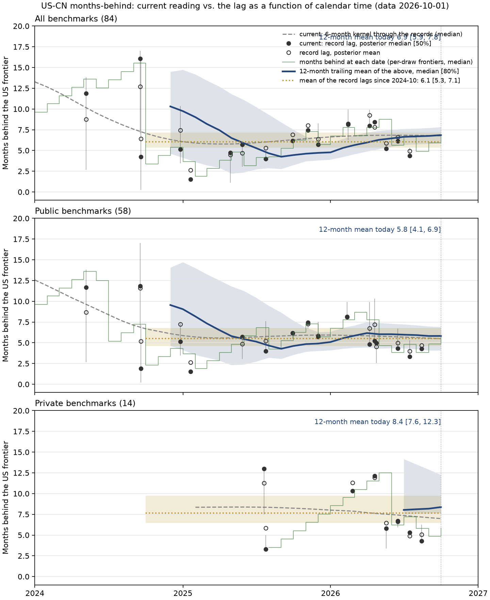

# Why the US-CN months-behind figure has few dots, and why they scatter (2026-10-20)

*Implemented the same day: proposal 3 (dots as posterior means, `LEADER_SD_CAP`) and the
months-behind function of proposal 1 (`analysis.frontier_gap.lag_function`, `trailing_mean`,
the table's second row `lag_12m_mean`). The figures' curve was switched to the twelve-month mean
and then put back to the 6-month kernel through the record lags at the user's request: the
curve passes through the records. Both notes regenerated on the 2026-10-01 data. The scripts
here read the per-draw ECI-H the way the first study did, so they still reproduce the numbers
below; `scripts/study3.py` holds the later tests (a 3-score rule for records, a causal kernel,
stability across data generations), `scripts/etape5_illustration.py` the figure of the
months-behind function. Later the same day, a 3-score rule for records (`RECORD_MIN_OBS`) was tried: on all
benchmarks the three 2-score records went, four well-measured releases came in and the headline
rose from 6.8 to 7.6 months; but the private scope, whose Chinese candidates hold two scores by
nature (18 of 20), fell to one record, and one rule for every scope is a condition (the scopes
must compare). The rule is back to 2 everywhere; the option `--record-min-obs 3` keeps the
sensitivity reading. `scripts/study4.py` tests uniform alternatives (a probabilistic record rule,
precision weights, the top-2 frontier). The top-2 reading (`--frontier-k 2`: records and runners-up
against the leader's second-best, per draw; `lag_top2_*.png`, `scripts/top2_*`) was then made the
default, the user choosing less noise: twice the points, intervals a quarter narrower, 6.5 months on
all benchmarks for US-CN against 6.8 with the records alone, 5.1 against 5.9 on public.*

Investigation of `frontier_gap_country_lag.png` on the data generation of 2026-10-01 (the fits the
note was built on: `canonical_humanmerge/` and the three class fits). Every number below was
recomputed from the per-draw ECI-H of those fits with the scripts in `scripts/` (`extract.py`
saves the draws once per scope, `study.py` and `study2.py` run the variants, `fig.py` draws
`lag_variants.png`). Records since 2024-10-01 unless said otherwise; "all" is the all-benchmarks
scope, the one the headline reads, "public" the scope the print figure draws.

## 1. Why so few dots

A dot is a **record**: a Chinese release whose posterior-median ECI-H beats every earlier Chinese
release (one effort per family, one release per organization and day). That rule turns 150 Chinese
candidates since 2024 (all benchmarks) into 17 dots, and 98 public candidates since 2024-10 into
14. The print figure then draws two scopes only (public: 17 dots since 2024, private: 6), not the
all-benchmarks scope, and two dots whose centres touch are merged into one split disc.

Nothing is lost by a bug: the count is the method's. Three things could add dots honestly:

- **Draw the all-benchmarks scope** (17 dots since 2024, the scope the headline number comes from).
- **Probable records.** Reading records per posterior draw instead of on the medians, 23 Chinese
  candidates hold the frontier in at least 20% of draws (all benchmarks, since 2024-10) against 14
  median-records; the extra ones are mostly sibling efforts of a record (kimi-k3 next to
  kimi-k3_max), but four are distinct releases (qwen3-235b-a22b_thinking of 2025-04,
  DeepSeek-V3.1-Terminus, glm-5, qwen3.6-max-preview). Drawn lighter, with their lag read in the
  draws where they hold the frontier (which is the coherent conditional: a non-record's
  unconditional lag overstates the frontier's), they add a handful of points. Modest gain.
- **The lag as a function of calendar time** (section 3) fills the whole axis by construction and
  makes the dots secondary.

## 2. Why the dots scatter: what the noise is made of

The posterior SD of one record's lag is 2.8 months on average (all benchmarks). Freezing one side at
its posterior median splits it: **1.5 months come from the Chinese record's own level** (SD 2.7
ECI-H against a US frontier slope of 23 ECI-H a year, 1.9 a month), **2.7 months from the US side**:
which US model first beat the record, and when. The US side dominates, and it is carried by
thinly measured efforts. On average 34% of the crossing draws (51% on public benchmarks) name a US
model with three scores or fewer; for the 2026 records it is 57-60%, on gpt-5-pro-2025-10-06_high
(3 scores, posterior SD 2.8) and gpt-5.2-pro-2025-12-11_xhigh (2 scores, SD 3.4); for DeepSeek-V3
it is 87%, with PaLM 2-L (2 scores, SD 10.6) giving the 19-month tail. The lag draws are discrete
(8 to 21 distinct values per record, each a release date difference), so a record's posterior is
bimodal whenever two US models split the draws: kimi-k2.6_thinking is 8.4 months behind if GPT-5
Pro beat it (52% of draws) and 4.8 if not.

Two facts say the scatter between dots is this uncertainty and not a moving lag:

- **Dispersion test.** The precision-weighted chi-square of the 14 record medians about one
  constant is 7.0 on 13 degrees of freedom (ratio 0.54; public: 0.48); the weighted linear trend of
  the lag is +0.5 ± 1.5 months a year (public: -1.1 ± 1.3). The record medians are *less* dispersed
  than their posteriors predict (the draws of neighbouring records are correlated, they share the
  US model that beat them). Since late 2024 the data support one constant lag, about 6 months.
- **Bandwidth of the smoother.** The leave-one-out predictive error of the kernel curve through the
  records is 0.56-0.63 (standardized) for every bandwidth from 3 months to infinity: the 6-month
  curve's bends are not predictive. They follow the sawtooth structure of the problem: a record
  that barely tops the previous one is beaten by the same US model, so its lag is the previous
  record's plus the months between the two releases (7 of 13 consecutive pairs share the first US
  model above). The curve then ramps up until a large Chinese step (DeepSeek R1, Qwen3.7-Max,
  Kimi K3) resets it.

Which US side rule removes the thin-model noise without removing frontier models? None cleanly:

| leader candidates | mean posterior SD of a lag | pooled lag | what it drops |
|---|---|---|---|
| as now (425 US) | 2.78 | 5.8 | nothing |
| at least 3 scores (353) | 1.58 | 4.9 | GPT-5 Pro high (3 scores): two record medians move (the earlier objection stands) |
| posterior SD < 4 (329) | 1.57 | 5.2 | Claude Mythos Preview, Fable 5 max, GPT-6 Astra: the 2026 frontier (SD 4.1-5.2) |
| posterior SD < 6 (402) | - | - | 23 old small models (PaLM 2, GPT-2 XL, Dolly) and gpt-5.4 cyber (2 scores): only the 19-month tails of the 2024 records |

The crossing is also what the per-draw posterior says about *which* US model beat a Chinese
record, and reading it on the median path of the US running max instead (Chinese uncertainty only)
under-disperses the records (chi-square ratio 2.6): the US-side uncertainty is real and has to stay
in the bars. The real fix is upstream: the pro and xhigh efforts that hold the 2025-2026 US
frontier are scored on two or three benchmarks each; more scores for them would tighten every
lag of 2026 (data wishlist).

## 3. Proposals

Ranked by how much they change the figure for how little they change the method.

1. **Read the lag as a function of calendar time, from the two per-draw frontiers.** In each
   draw both frontiers are step functions of the candidates' draws (`GroupFrontier.env_E` holds
   them already); the months behind at date t are t minus the first date the US frontier reached
   the Chinese frontier's level of t. It is defined every month, uses every Chinese model through
   the running max (no median-record selection, no winner's curse on the record side), and its
   posterior band needs no kernel. Drawn thin it is the sawtooth of `lag_variants.png` (the dots
   are its minima); its **12-month trailing mean** is the smooth curve and the headline: today 6.9
   [5.9, 7.8] on all benchmarks against 6.8 [6.1, 7.5] for the record mean, 5.8 [4.1, 6.9] on public.
   The two differ when records are sparse, because the record mean averages the minima of the
   sawtooth: on private benchmarks the time average is 8.4 [7.6, 12.3] (on a record set that still
   has to apply `RECORD_FRONTIER_TOL` to the class's Chinese envelope, so do not quote it yet)
   against the 6.8 of the records. "How far behind on an average day" is the time average; the
   record lag is "how far behind at the moment China sets a record", a smaller number by the half
   of the mean gap between records. Implementation: one function in `analysis.frontier_gap` on
   the two envelopes plus a grid; in a class scope, drop the off-frontier follower models from the
   envelope the way `off_frontier_records` drops them from the records.
2. **Replace the 6-month kernel curve** by that 12-month mean, or, if the records stay the figure,
   by a flat band since 2024-10 (6.1 [5.3, 7.1] all, 5.5 [4.6, 6.8] public, the draw-wise mean of
   the record lags) with the dispersion test in the caption. The LOO says no bandwidth is better
   than another; a wiggly curve claims structure the data do not have.
3. **Dots as posterior means with their 50% bars.** The lag posterior is discrete and often
   bimodal, so the median jumps between two release dates when the split crosses 50%; the mean
   moves with the split. Mean jump between consecutive dots 1.8 → 1.6 months (all), 1.8 → 1.5
   (public). With a guard on the leader side at posterior SD > 6 (old small models only), the
   19-month tails that pull the 2024 means up disappear. Small change, cheap.
4. **More dots**: draw the all-benchmarks scope in the print figure, and the probable records (P ≥
   0.2) lighter. Also say in the caption how many candidates the records come from (14 of 98).
5. **Data**: scores for the pro and xhigh efforts (GPT-5 Pro, GPT-5.2 Pro, GPT-5.4 Pro) on more
   benchmarks: they hold the US frontier and carry half of each 2026 lag's uncertainty.

Tested and not recommended:

- **Linear interpolation of the US frontier between its records** (Epoch's reading) moves every
  lag up by 0.8 months (the crossing is placed before the release that overshot the level) and
  leaves the posterior SD unchanged (2.78 → 2.84): a different estimand, no less noise.
- **A coverage or SD rule on the leader side** (table above): each drops frontier models.
- **Crossing on the median path of the US running max**: under-dispersed, hides real uncertainty.

## Numbers recomputed here (all benchmarks, records since 2024-10)

| | median lag | posterior SD | first US model above |
|---|---|---|---|
| DeepSeek-V3 | 5.1 | 5.7 | o1-mini high 39% (3 scores), Llama 3.1 405B 22%, PaLM 2-L 10% (19 months) |
| DeepSeek-R1 | 1.5 | 3.6 | o1 60% |
| kimi-k2-thinking | 7.4 | 2.6 | gemini-2.5-pro-exp 53% (shared with the two previous records) |
| kimi-k2.6_thinking | 8.4 | 2.1 | gpt-5-pro high 52% (3 scores); 4.8 months otherwise |
| glm-5.2_max | 6.1 | 1.5 | gpt-5.2-pro xhigh 47% (2 scores) |
| kimi-k3_max | 4.4 | 1.3 | gpt-5.4-pro xhigh 51% (4 scores) |

Full tables: `scripts/study_public.log`, `scripts/study_private.log` (the all-benchmarks run prints
the same tables; re-run `study.py <scratch> all`).
