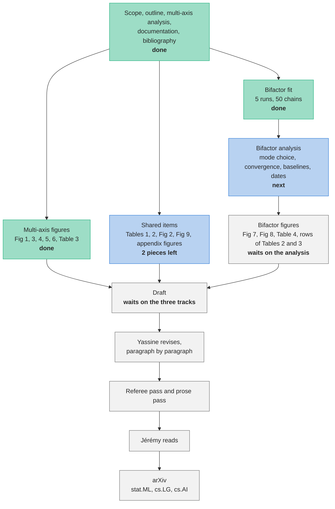

# Preprint status

Updated 2026-11-13. The plan itself is in `PLAN.md` section 0e (outline, figure list, numbers).
This file holds the flow chart and what is done.

Green is done, blue is open and can start now, grey waits on the box above it.

## Plan of the document

Shaped on the Rosetta Stone paper: five sections, one figure or table per results subsection,
model fit and sensitivity in appendices. No section has prose yet. The last column says whether
the figures, tables and numbers a section needs exist.

| section | name | figure or table | material |
|---|---|---|---|
| 1 | Introduction | Fig 1, frontier trend and human baselines per axis (multi-axis model, mode A) | ready |
| 2.1 | Data | Table 1, feeds and scope | ready |
| 2.2 | Single-axis model with human baselines | | ready |
| 2.3 | Multi-axis model | Fig 2, model schematic | ready |
| 2.4 | Bifactor model | | ready |
| 2.5 | Human baselines on the axes | | ready |
| 2.6 | Inference and posterior modes | | multi-axis ready; the bifactor mode numbers wait on the analysis |
| 3.1 | Model comparison | Table 2; Fig 3, human scores under the single-axis model | ready but for the bifactor row of Table 2 |
| 3.2 | Multi-axis model: loadings and posterior modes | Fig 4, loadings per axis; Fig 5, benchmark allocation in mode A against mode C | ready |
| 3.3 | Multi-axis model: frontier trends and human baselines | Fig 1; Fig 6, the same for mode C; Table 3 | ready |
| 3.4 | Bifactor model: loadings, frontier trends and human baselines | Fig 7, Fig 8; its columns in Table 3 | waits on the bifactor analysis |
| 3.5 | Agreement between the two models | Table 4 | waits on the bifactor analysis |
| 3.6 | Frontier gaps | Fig 9 | ready |
| 4 | Discussion: posterior mode and model structure, benchmark coverage, human baseline placement, forecasts, limits of the benchmarks | | written at the draft stage |
| 5 | Conclusion | | written at the draft stage |
| A | Related work | | bibliography ready |
| B | Data and coverage matrix | coverage matrix | ready |
| C | Priors | | to write from the schematic and the configuration |
| D | Convergence per mode | | multi-axis ready; bifactor waits on the analysis |
| E | Model fit | predicted against observed; LOO-PIT; comparison with Epoch's index | LOO-PIT figure left |
| F | Sensitivity | | no refits: limitation sentences |

The single-axis index is not a results section. It stays as the baseline of the model comparison,
as the scale of the frontier gaps, and for one fact: it mispredicts the human scores (Fig 3).

## Items

| item | state |
|---|---|
| Scope, outline, multi-axis analysis, documentation, bibliography | done |
| Fig 1 and Fig 6, frontier trend and human baselines per axis (modes A and C) | done |
| Fig 2, model schematic | done |
| Fig 3, human scores under the single-axis model | done |
| Fig 4, loadings (modes A and C) | done |
| Fig 5, benchmark allocation, mode A against mode C | done |
| Fig 9, frontier gaps | done |
| Appendix: coverage matrix, predicted against observed, comparison with Epoch's index | done |
| Appendix: LOO-PIT of the multi-axis model | open, can start now |
| Table 1, data by feed | done |
| Table 2, model comparison | single-axis and multi-axis rows done; bifactor row waits on the analysis |
| Table 3, human baselines passed | modes A and C done; bifactor columns wait on the analysis |
| Bifactor fit | done 2026-11-12: 5 runs, 50 chains, 10 posterior modes; the upstream fit's chosen mode is reproduced (12 / 50 chains, loadings correlate at 0.993 to 0.999) |
| Bifactor analysis: mode choice by the stated rule, convergence inside the mode, human baselines, crossing dates | open, next |
| Fig 7, Fig 8, Table 4 (bifactor) | wait on the analysis |
| Draft | waits on the three tracks |
| Yassine's revision, referee and prose pass, Jérémy's reading, submission | wait on the draft |

## Owed by people

| what | who | state |
|---|---|---|
| Go for bifactor run 5 | Yassine | settled, the run finished 2026-11-12 |
| Agreement on the mode rule and on agent-drafted prose | Jérémy | open |
| The two model names ("multi-axis model", "bifactor model") | Yassine | open |
| Yes or no for five benchmarks on mode C (GPQA Diamond Biology, GPQA Main Biology, MMLU Biology, MMLU Chemistry, SpireClimb) | Yassine | open |
| Which trace the README's mode numbers describe | Yassine | open |
| `git push origin main` | Yassine | open |

## Not committed

The bifactor runner session committed nothing after run 1. Its logs and notes for runs 2 to 5
(`gsum_runs/`) and the fit folder's tables are uncommitted. The fit folder's tables were written
on all 50 chains, where the committed ones read the chosen mode only, so committing them is a
choice to make after the analysis.
