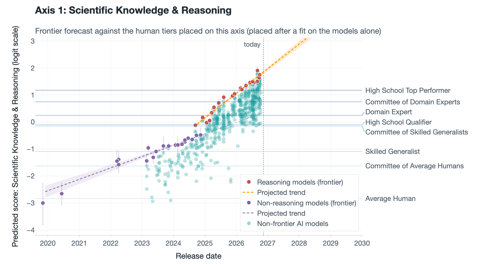
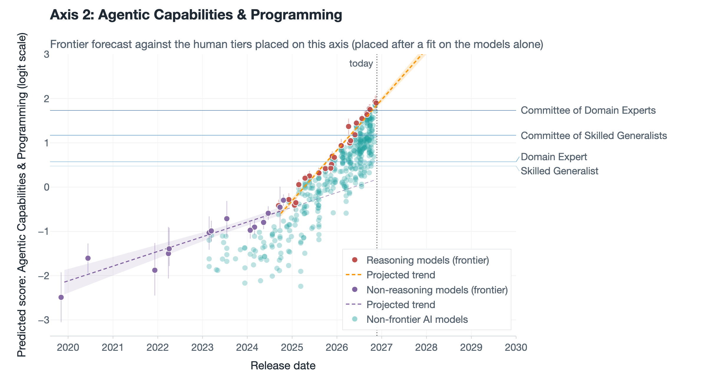
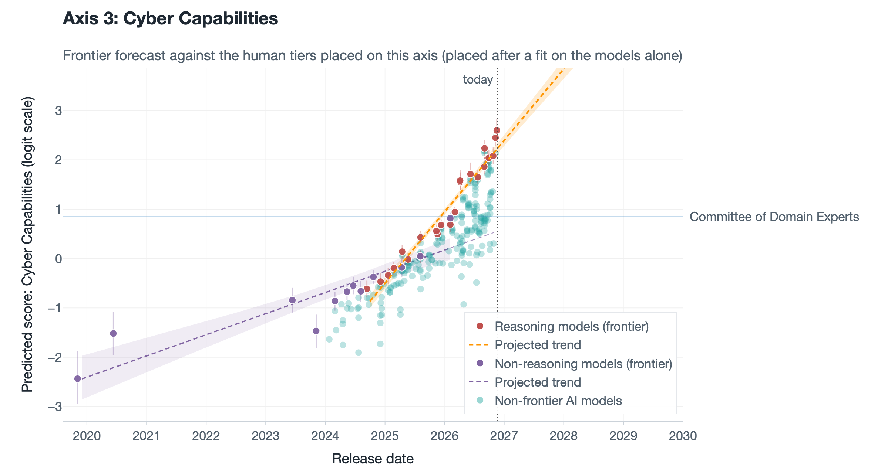
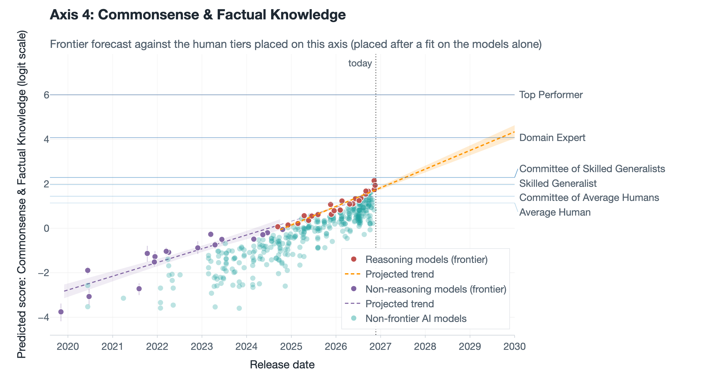
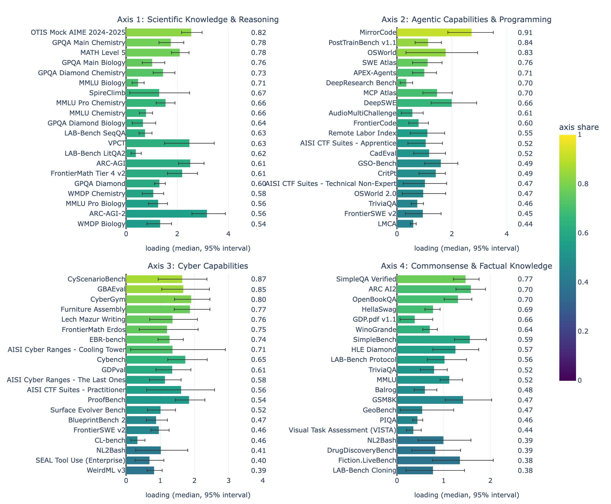

# Multi-Axis ECI

A multi-axis, Bayesian version of the **Epoch Capabilities Index** ([ECI](https://epoch.ai/eci)) with human baselines placed on its axes, and the frontier forecasts it supports.

The method was published in [*Multi-Axis Bayesian Epoch Capabilities Index with Human Baselines*](https://gpaipolicylab.org/blog-5) (GPAI Policy Lab, 2026-09-07). That post's code, data and results are frozen on the branch [`blogpost-frozen`](https://github.com/General-Purpose-AI-Policy-Lab/Multiaxis_ECI/tree/blogpost-frozen), its tables on `main` under `5_outputs/pre_pipeline/`. This README describes `main`, fitted on the data of [`benchmark-data-pipeline`](https://github.com/General-Purpose-AI-Policy-Lab/benchmark-data-pipeline) (run of 2026-11-18); where a number comes from the post, it says so.

## The idea

The ECI compresses many benchmark scores into one number per model, following the [Rosetta Stone paper](https://arxiv.org/abs/2512.00193). The previous post, [Mapping AI capabilities to human expertise on the Rosetta Stone scale](https://www.lesswrong.com/posts/cfbdyJGbHkY8rPesE/mapping-ai-capabilities-to-human-expertise-on-the-rosetta-1) (code: [`rosetta-human-baselines`](https://github.com/General-Purpose-AI-Policy-Lab/rosetta-human-baselines)), put human baseline tiers on that scale, which exposed a problem. Humans score near-perfectly on abstract-reasoning benchmarks like ARC-AGI or VPCT and near chance on GPQA-type benchmarks, while many models show the opposite pattern. No single ordering produces both.

This repository rebuilds the index in PyMC as a **K-axis compensatory Beta-MIRT**, an item-response model with a Beta likelihood. Every ability comes with its uncertainty. The K=4 flagship is fitted on the models alone, and the human tiers (nine: six individual tiers from the Average Human to the Top Performer, and three committees) are placed on each of its axes afterwards (see [Method](#method)). The K=1 anchored index, which we call **ECI-H** (ECI with Human baselines) to keep it distinct from Epoch's published ECI, fits them inside.

## Current results: the K=4 flagship

The flagship lives in `5_outputs/data20261118/mirt_lineageprior_lineagebm/` (fitted 2026-11-18 to 20; the flagship of the 2026-10-19 data stays in `5_outputs/data20261019/`). Its axes are named by hand after the benchmarks most collinear with them (the largest share of their loading variance), in the fit folder's `axis_names.json`; a refit keeps a name only while its signature benchmarks still define the axis (see [docs/plots.md](docs/plots.md)):

1. **Scientific Knowledge & Reasoning** (OTIS Mock AIME, GPQA Main Chemistry and Biology, MATH Level 5, MMLU Biology and Chemistry, with SpireClimb, VPCT, ARC-AGI and WMDP)
2. **Agentic Capabilities & Programming** (MirrorCode, PostTrainBench, OSWorld, SWE Atlas, APEX-Agents, with DeepResearch Bench, MCP Atlas, DeepSWE)
3. **Cyber Capabilities** (CyScenarioBench, GBAEval, CyberGym, with Furniture Assembly, FrontierMath Erdos, EBR-bench, AISI Cyber Ranges, Cybench)
4. **Commonsense & Factual Knowledge** (SimpleQA Verified, ARC AI2, OpenBookQA, HellaSwag, with GDP.pdf, WinoGrande, SimpleBench, HLE Diamond)

Mathematics and abstract reasoning share an axis with scientific knowledge, agentic and cyber benchmarks load apart, and the commonsense and factual benchmarks form the fourth axis. These are the axes named on the flagship of the 2026-10-19 data, found again (their loading columns correlate at 0.97, 0.90, 0.92 and 0.93 with the named ones, and every signature benchmark is still among its axis's top nine). The axes are distinct: the largest correlation between their abilities is 0.56 (axes 1 and 2).

The 50 chains fall into four posterior modes (see [Limitations](#limitations)). The figures, the dashboard and the forecasts read mode C (17 chains), selected by integrated leave-one-out over mode A, the best log-density and the most chains (24), which carries another solution.

**Fitted before five benchmarks moved to item counts.** The flagship was sampled before SpireClimb, the AISI Cyber Ranges Cooling Tower and The Last Ones, CyScenarioBench and MultiChallenge became Beta-binomial (`items`) benchmarks (commit `fcea240`, 2026-11-23); it scores them with the Beta density, as it was fitted. The item table it saw is frozen beside its trace (`benchmark_n_items_fitted.csv`), which every rebuild reads (`FitSpec.binomial_n`), so its likelihood, its leave-one-out and its human placement reproduce; the canonical K=1 index of the same data already uses the new item counts.

Per axis, the frontier releases of reasoning models (red) and of the others (purple) each get their own fitted line; the reasoning models' line is projected to 2030 (orange, 80% band) against the human tiers (horizontal lines) placed on that axis. The vertical scale is each test-taker's predicted score on the benchmarks the axis dominates, on the logit scale and in standard deviations of the models (mean 0), rather than its fitted ability on the axis alone (see [Method](#method)). A tier is drawn only where its own scores place it, on benchmarks that measure the axis, so the agentic and cyber axes carry few tiers: no human baseline exists for most of their benchmarks.









The 20 benchmarks with the largest share of each axis, their loadings (median and 95% interval) and that share:



`python docs/make_readme_figures.py` redraws these five figures from the flagship trace ([downloaded from its release](#traces)), with the builders of the per-fit folders.

The K=4 fit sees 5,869 observations, 916 models and 103 benchmarks; 46 human scores (counted once per axis) fall on benchmarks that measure an axis and place the tiers. The canonical K=1 index, which also applies the curated exclusions and fits the tiers inside, sees 4,653 observations on 89 benchmarks.

## Setup

Python 3.11 or later, with the pinned scientific stack (`pyproject.toml`):

```bash
uv venv --python 3.11 .venv && uv pip install -e . --group dev   # or: pip install -e .
plotly_get_chrome -y                                             # once per env; figure export needs it
python -m multiaxis_eci sync                                     # 0_input/ from ../benchmark-data-pipeline
python -m pytest -m "not slow"                                   # under a minute
ruff check .
```

On macOS with the Command Line Tools for Xcode 27 or later, PyTensor's C compiles fail on the `-ld64` flag it adds for the classic linker; importing `multiaxis_eci` installs a shim that strips the flag once the linker is seen to refuse it (`multiaxis_eci/pytensor_compat.py`).

The pins are load-bearing: arviz >= 1.0 replaces `InferenceData` with xarray's `DataTree`, and nutpie >= 0.16.8 hands a `DataTree` back from a zarr store, either of which breaks this code and the golden logp tests. `nutpie` (Rust NUTS) is the default sampler, 2-3x faster than PyMC NUTS on CPU.

## Data

The scores, release dates, organizations, countries, categories, chance floors, known ceilings, access classes and human baselines all come from [`benchmark-data-pipeline`](https://github.com/General-Purpose-AI-Policy-Lab/benchmark-data-pipeline). `python -m multiaxis_eci sync` copies the consumer views and tables of its latest run (`3_views/<YYYYMMDD>/`, `2_database/<YYYYMMDD>/`) from a checkout (the sibling directory by default, `--pipeline PATH` otherwise) into `0_input/`, and writes `provenance.json` with the pipeline commit and the run's date. The copies are tracked, so a fit is reproducible without the pipeline. Anything wrong in the data (a date, an alias, a floor, a benchmark's inclusion) is fixed in the pipeline, then synced here.

**After every sync, run `python 1_curated/0_audit_sync.py`**: it lists, for each new model, benchmark and human baseline, the curated tables still to complete, the decisions to take (a benchmark entering the index, a new lineage, a human baseline) and what looks unexpected (frontier jumps, revised scores, effort inversions), in `5_outputs/<data generation>/sync_audit.md`. The full procedure across both repositories is in [`.claude/skills/data-refresh/SKILL.md`](.claude/skills/data-refresh/SKILL.md).

Two modeling-stage filters apply at load time: the curated exclusion list of the canonical index, and the drop of isolated families, every release (base model plus snapshot, all reasoning efforts and run variants together) whose observations sit on a single benchmark in the fit's scope. Such a family carries no cross-benchmark information; `--keep-isolated-families` restores them.

What belongs to the model stays in `1_curated/`: the "easy for humans" exclusion list of the canonical index, the reviewed lineage map and its overrides, the data-driven SOTA list, the reviewed clips of below-floor scores, the models' openness labels, the content judgments of the human placement and Epoch's reference ECI table. See [`1_curated/README.md`](1_curated/README.md).

Every output goes under `5_outputs/<data generation>/`, named after the day of the pipeline run it was fitted on (`config.DATA_TAG`): the flagship is `5_outputs/data20261118/mirt_lineageprior_lineagebm/`, the canonical K=1 index `5_outputs/data20261118/canonical_humanmerge/`. A fit on a newer build never overwrites an older one. `5_outputs/pre_pipeline/` holds the post's fits as they were published.

## Traces

The posterior traces (`*.nc`, ArviZ netCDF) are too large for git and are not in a clone: each fit folder holds its tables, axis names, modes file and human placement, but not its trace. The traces of the main fits are attached to a [GitHub release](https://github.com/General-Purpose-AI-Policy-Lab/Multiaxis_ECI/releases), one per data generation, tagged at the commit they go with. Release [`traces-data20261118`](https://github.com/General-Purpose-AI-Policy-Lab/Multiaxis_ECI/releases/tag/traces-data20261118) holds the current flagship and its K=1 baseline; the flagship's trace (2.9 GB) is above GitHub's 2 GB limit per file, so it comes in two parts to put back together. Release [`traces-data20261019`](https://github.com/General-Purpose-AI-Policy-Lab/Multiaxis_ECI/releases/tag/traces-data20261019) holds the flagship of the 2026-10-19 data and the g + deviations bifactor (gsum). Each release's notes list its files, the folder each goes in and their checksums. To fetch the flagship's:

```bash
cd 5_outputs/data20261118/mirt_lineageprior_lineagebm/
gh release download traces-data20261118 -p 'trace_mirt_k4_lineageprior_lineagebm.nc.part-*' -p 'trace_mirt_k1.nc' -p SHA256SUMS
cat trace_mirt_k4_lineageprior_lineagebm.nc.part-* > trace_mirt_k4_lineageprior_lineagebm.nc
shasum -a 256 -c SHA256SUMS --ignore-missing
```

Every script that reads a fit takes the trace's path (`--trace`), and the figures, diagnostics, residuals and factor scores regenerate from it. A trace not in a release is regenerated with the commands of [Run](#run).

## Run

The K=4 flagship (models only, skew-normal abilities and estimated ceilings are the defaults; `--humans`, `--normal-theta` and `--no-ceiling` turn them off and say so in the folder name): 2,000 draws after 2,000 tuning steps on 10 chains per run, five runs with their own seeds (44 to 48) merged into 50 chains, so that many starting points explore the modes (copy the trace out of the fit folder before each added run, as it writes over it):

```bash
python 3_fit/fit.py --K 4 --lineage-prior --lineage-bm --chains 10 --seed 44
python 3_fit/fit.py --K 4 --lineage-prior --lineage-bm --chains 10 --seed 45 \
    --merge-chains <copy of the trace so far>     # then seeds 46, 47, 48 the same way
```

Traces on disk keep every second draw (`--save-thin`, `config.SAVE_THIN` = 2), with the posterior and the pointwise log-likelihoods in float32 and without nutpie's per-parameter sample stats (`persistence.save_trace`, whatever wrote the trace): one in five lost up to 60 % of a loading's effective sample size, float32 moves no quantile by more than 1e-5 of its Monte Carlo error (2026-11-03). Convergence is checked on the full run. While a nutpie fit runs, its draws stream to a zarr store beside the trace instead of accumulating in RAM (`--stream-draws`, on by default), so the machine stays usable during a ten-hour fit.

Then find the posterior modes, write the axis tables on the chains the deliverables read, place the human tiers, render the fit's figures (French versions under `fr/`) and rebuild the dashboard. The deliverables read the best mode by log-density, or the `selected_chains` of the modes file; a refit sets the old modes file aside, so a selection never outlives its chains:

```bash
python 4_diagnostics/diagnose_chains.py --trace <trace> --write-modes
python 4_diagnostics/diagnose_chains.py --trace <trace> --write-tables   # once selected_chains is final
python 4_diagnostics/5_place_humans.py --trace <trace>
python 4_diagnostics/3_plot_mirt.py --forecast --trace <trace>
python 4_diagnostics/4_build_dashboard.py --force-all
```

The canonical K=1 index, 2,500 draws x 8 chains, writing the full ECI-H deliverables to `5_outputs/<data generation>/canonical_humanmerge/`:

```bash
python 3_fit/fit.py --preset canonical --human-merge
```

`--human-merge` is the human tier order every analysis uses: the canonical index fits it, and the flagship's placement of the tiers imposes the same order. It is deliberately not a default, so no fit imposes an order on the human tiers without saying so in its folder name.

ECI-H is the per-draw affine transform of ability pinned at Claude 3.5 Sonnet (2024-06-20) = 130 and GPT-5 (2025-08-07, high) = 150, Epoch's own anchors (`config.ANCHOR_LOW`, `ANCHOR_HIGH`, since 2026-11-19). ECI-H numbers published before that date sit on the previous anchors (the October 2024 Sonnet, GPT-5 medium): on the 2026-11-18 canonical, new ≈ 130 + 0.805 × (old − 126.9). Every other flag, the sensitivity fits (a joint K=4 fit with the tiers inside, `--human-merge`; a fit without ceilings) and where a fit's output lands: [docs/cli.md](docs/cli.md).

## Layout

```
.
├── 0_input/             # step 0: the pipeline's views and tables, synced (all_scores_flat, human_baselines, models, benchmarks, manifest, provenance)
├── 1_curated/           # step 1: inputs specific to this model, and its builder scripts (SOTA list, lineage map, model openness, ...)
├── 2_model/multiaxis_eci/  # step 2: the library: config, data loading, models, analysis, figures, sync
├── 3_fit/fit.py         # step 3: the fit CLI (canonical preset + exploration)
├── 4_diagnostics/       # step 4: post-fit tools, the numbered four in reproduction order
├── 5_outputs/           # step 5: everything a fit writes, one folder per data generation (data<YYYYMMDD>/), then per fit: tables, trace (not tracked: see Traces), figures/; pre_pipeline/ holds the post's fits, open_closed_frontier/ and us_cn_frontier/ the open-weights vs closed and US vs Chinese frontier notes
├── 6_writeups/          # step 6: the post's figure scripts (6_writeups/blogpost/), the dashboard's card registry
├── archive/             # kept for the record, not maintained: notebooks (one-off investigations), results_old (superseded fits)
├── docs/                # model math, CLI reference, figure catalogue, the README's figures (figures/, make_readme_figures.py)
├── tests/               # fast unit tests + golden logp locks
└── index.html           # the dashboard of the current fits (tracked, served as is)
```

Numbered entries are the reproduction path, in order: inputs, curation, model, fit, diagnostics, outputs, write-ups. Everything else is a reference.

Full model math, priors and identification: [docs/model_math.md](docs/model_math.md). Figures and how to read them: [docs/plots.md](docs/plots.md). What each post-fit script does: [4_diagnostics/README.md](4_diagnostics/README.md).

## Method

Each test-taker *m* has K abilities θ forming a skill profile, the way a student can be strong in algebra and weak in essay writing. Each benchmark weighs those skills through K non-negative loadings *A*, which also set how sharply it separates test-takers, what psychometrics calls discrimination. Difficulty *D* is the bar the weighted skills must clear. A chance floor *c*, fixed per benchmark, starts the curve where guessing does, and a ceiling *d* ends it where a perfect model would still lose points to wrong answer keys and ambiguous items:

<p align="center"><em>µ = c<sub>b</sub> + (d<sub>b</sub> − c<sub>b</sub>) σ( Σ<sub>k</sub> A<sub>b,k</sub> θ<sub>m,k</sub> − D<sub>b</sub> )</em>,  &nbsp; <em>p ~ Beta(µφ<sub>b</sub>, (1−µ)φ<sub>b</sub>)</em>,  &nbsp; observed <em>y N<sub>b</sub> ~ Binomial(N<sub>b</sub>, p)</em></p>

Most scores are a share of a benchmark's N<sub>b</sub> items, so they enter as y N<sub>b</sub> successes of a Beta-binomial: item sampling sets a noise floor no benchmark can fall below, and a score of 0 or 1 is an ordinary outcome. The 23 benchmarks whose score is not a share of items (correlations, areas, rubric fractions, dependent steps of one scenario) keep the Beta density y ~ Beta(µφ<sub>b</sub>, (1−µ)φ<sub>b</sub>). N<sub>b</sub> and that split are in `1_curated/benchmark_n_items.csv`.

This is the *compensatory* family: a strong skill can make up for a weak one inside the sum. A soft-minimum link nests it (`--link semicomp`, a learned sharpness β; β → 0 gives back the sum); on the models it predicts held-out scores no better, and a hard minimum (`noncomp`) predicts them worse. The derivations and the tests are in [docs/model_math.md](docs/model_math.md).

**The data is sparse.** The test-taker by benchmark matrix is filled at about 6%, and the average test-taker has six scores. Many arrangements of abilities and loadings explain those scores equally well, so unconstrained runs land on different solutions. Ordering priors identify the fit:

- `--lineage-prior --lineage-bm` add a **soft** prior along each vendor's release chain. A release is nudged above its predecessor, more over a longer gap, but can regress if the data says so. Thinking-effort variants attach to their base release and are not ordered among themselves. Without it, chains land on separate solutions hundreds of nats apart.
- `--human-merge` sets a **hard** partial order on the human tiers (the canonical index, and the placement below). A Domain Expert is at least as good as a Skilled Generalist, a committee at least as good as its members, on every axis. It says nothing about the size of the gaps, and leaves genuinely incomparable tiers unordered.

**Estimated ceilings.** Each benchmark's ceiling is d<sub>b</sub> = 1 − e<sub>b</sub>, the gap e<sub>b</sub> drawn from benchmark-forecasting's population of gaps, 0.25 · Beta(1.43, 4.67) (mean 0.06), and never below the best score observed on the benchmark, by a model or a human baseline; a ceiling the pipeline records is kept fixed. Without ceilings, the flattening of top scores has to be explained by abilities and slopes, and an axis partly stands in for the missing plateaus. At equal axis structure the ceilings predict held-out scores better (robust mixture leave-one-out, +56 ± 12 nats on the 4,967 reliable scores), and the estimated ceilings agree with benchmark-forecasting's (median gap 0.054 against 0.055). A ceiling trades off against its benchmark's slope and leaves the prior only where many top scores press on it ([docs/model_math.md](docs/model_math.md) §4.4; the comparison with the fit without ceilings, `mirt_lineageprior_lineagebm_noceiling/`, is in the flagship's `investigation/README.md`).

**Skew-normal abilities.** The abilities of the models outside the release chains, and of each chain's founder, are independent skew-normal per axis, standardised, with a shape learned per axis. A Gaussian block can be rotated without changing the prior or the likelihood, so chains settled in different orientations; skewed columns fix them, and match the abilities' shape, a left tail of old and weak models below the frontier. It reaches the best region from more starting points, with a better leave-one-out (`5_outputs/sampler_study/GEOMETRY_REPORT.md`). The canonical K=1 index keeps the Gaussian prior.

On by default with no flag over them: non-negative loadings, the Beta-binomial likelihood and the effort means (a release's effort levels as one learned direction); the K-axis fits also apply the fixed-c chance floors (the pipeline's `lower_bound`) and hierarchical benchmark noise. In the canonical K=1 index, a release's effort variants share one level, so a variant scored on one benchmark only sits near its release. Each has an opt-out documented in [docs/cli.md](docs/cli.md).

**Placing the human tiers** (`4_diagnostics/5_place_humans.py`, `analysis.human_placement`). Fitted with the models, the human scores are too few to pin the tiers on four axes, and the compensatory sum let them sit about 5 sd below every model on one axis and 8 above on another. So the flagship leaves them out and places them afterwards, one axis at a time, with the benchmark side frozen at the selected chains' medians:

- a benchmark measures the axis it is most collinear with (the largest share of its loading variance), and its human scores count there only if its content fits the axis's name, judged by hand pair by pair (`1_curated/human_axis_content.csv`; a plausible link is enough to keep one);
- on those benchmarks a tier's score follows the fit's own likelihood, ceilings included, its other axes set to those of a typical model at the same ability (a linear regression over the models), and the tiers keep the ordered prior above (`config.HUMAN_ORDER_MERGED`);
- a tier is drawn where it has a score of its own below the ceiling, or sits between two tiers that do; each placement is checked against the scores it rests on and the first model that reached each score (`human_placement.json`).

**Reading an axis** (`analysis.reading`, `config.AXIS_READING`). A fitted ability on one axis is one term of the sum above, and the data pin the sum far better than its terms: abilities can move between axes while every predicted score stays put, and a model then leads an axis without leading on any of its benchmarks. The figures therefore show, for each test-taker and axis, its predicted score on the benchmarks the axis dominates: the mean, weighted by axis share, of their predictors, each standardised over the models. On the commonsense axis of the 2026-10-19 flagship, 12 of the 20 best models by ability are beyond rank 100 on predicted scores, and the frontier's slope doubles (0.38 to 0.76 standard deviations a year); the other three axes barely move. A placed human tier is read as the typical model at its ability on the axis, which is what its placement assumed. The readings of the four axes are closer to one another than their abilities (correlations 0.92 to 0.97). The same figures on the fitted abilities are written under `theta/` in the fit's figure folder; loadings and tables keep the abilities ([docs/model_math.md](docs/model_math.md) §9).

**The forecast** starts from the models evaluated on an axis, keeps one effort per family (the best) and one release per organization and day, and splits them into reasoning models and the others. Each regime's frontier (the running top two by release date) gets one straight line, fitted on the posterior medians and weighted by their posterior SD; the reasoning line is projected from the first reasoning release to 2030, and crossing dates read the piecewise frontier against each human tier. The full rule: [docs/plots.md](docs/plots.md).

## Reading the results

**Axes have no fixed names, so they are labelled after sampling.** Swapping two axes leaves every prediction unchanged, because the swap moves the loadings `A` and the abilities `theta` together and only their product reaches the likelihood. Each draw picks its own labels, and they are fixed afterwards by collinearity: every draw's axes are permuted so that their loading columns line up with a common reference (an axis is recognised by which benchmarks load on it), and the axes are then numbered from the strongest.

Whether the chains agree on those axes is a different question, with its own number. Each chain's mean loading columns are matched to the pooled mean over every permutation and sign (all 24 of them at K=4), and the median correlation is reported per axis. Convergence is judged on identified quantities only (`eta`, `D`, `sigma_b`), because raw per-axis r-hat on `A` and `theta` is permutation-inflated.

**An ability is trustworthy only where it was measured.** A test-taker's ability on an axis rests on benchmarks that load on that axis. Models from 2021-2023 took only easy benchmarks, so their hard-axis ability is extrapolated, and can land high with a wide interval. Figures and forecasts use a model on an axis only where its own scores cover that axis (`candidate_mask`: the axis shares of the benchmarks it was run on sum to at least 1); the fit and the diagnostics keep every row.

## Limitations

- **The K=4 posterior is multimodal.** Its 50 chains (five runs of 10, seeds 44 to 48) fall into four modes: A, 24 chains, the best log-density; B, a single chain 1.0 nat below; C, 17 chains 1.2 nats below; D, 8 chains 62 nats below. C carries the four named axes. A is another solution, the one five chains found on the 2026-10-19 data (agentic and cyber benchmarks together, a visual axis; its loadings match that mode's at 0.91 to 0.93); B and D share a third. More chains find no new mode, only the same ones more often. The modes are not an extra axis but discrete ways, under non-negative loadings, of carving the same space.
- **Choosing the mode.** Log-density cannot choose between A and C, 1.2 nats apart, and PSIS-LOO cannot rank the modes: a large share of the observations get a Pareto k above 0.7. Integrating each score's own latent block out (`4_diagnostics/integrated_loo.py`, after Vehtari et al. 2016; each mode the average of its chains, 1,000 draws each) favours C: C − A = +29.6 ± 16.0 nats on every score, +11.3 ± 8.0 on the 3,939 it estimates reliably in every mode; B and D are no better than A (on the reliable scores, B −44.8 ± 13.8, D −31.2 ± 12.8 against A). On the 2026-10-19 data the same comparison gave the same verdict (the named solution ahead of A's by 26.7 ± 7.6). The deliverables read mode C, the modes file's `selected_chains` (user, 2026-11-23).
- **Few human scores per axis.** The tiers rest on the scores of the benchmarks that measure each axis: 31 on scientific knowledge & reasoning, 3 on agentic capabilities (OSWorld, The Agent Company, METR Time Horizons), 2 on cyber (Cybench, METR Time Horizons) and 10 on commonsense & factual knowledge. Where a tier has several scores they can disagree beyond what any one ability explains (the Skilled Generalist at 0.40 on MATH Level 5 but 0.97 on GSM8K; the Domain Expert above every model on LAB-Bench LitQA2 and below most on WMDP; on the commonsense axis, the Average Human's 1.00 on VPCT pulls it above what its OpenBookQA and TriviaQA scores give), and a crossing date read on the trend can differ from the date the frontier first reached a score on the benchmark itself.
- **The unordered canonical index splits.** Without the human tier order (a sensitivity fit), some chains settle in a second mode where MMLU, ARC (AI2) and GSM8K go flat and the Average Human rises above most tiers. The ordered index every analysis reads converges.
- **Data.** We need more of it and of better quality, especially for the human baselines. The 6% fill rate is what forced the extra assumptions above.
- **Benchmark-level scores.** We fit those rather than item-level answers, so the MIRT assumptions are not fully respected. The Rosetta Stone paper and the ECI have the same problem.
- **Calibration.** The predictive intervals come out wider than the data requires (leave-one-out PIT variance 0.067 at K=4 on the selected mode against 0.083 for a calibrated model), which makes the model somewhat more conservative than it should be.

## Resources

- Epoch Capabilities Index: <https://epoch.ai/eci>
- Rosetta Stone paper: <https://arxiv.org/abs/2512.00193>
- Alexander Barry's Bayesian ECI, which this rebuild follows: [Kicking the tires of the Epoch Capabilities Index](https://abstatisticalconsulting.substack.com/p/kicking-the-tires-of-the-epoch-capabilities-741)
- Epoch on benchmark scores carrying more than one dimension: [Benchmark Scores = General Capability + Claudiness](https://epoch.ai/gradient-updates/benchmark-scores-general-capability-claudiness)
- Epoch on the jump that came with reasoning models: [Have AI Capabilities Accelerated?](https://epoch.ai/publications/have-ai-capabilities-accelerated) (Denain and Barry, 2026)

## Authors

This project is co-authored by:

- [Yassine Essifi](https://github.com/linkofrivia), former Research Resident, GPAI Policy Lab
- [Jérémy Andréoletti](https://github.com/Jeremy-Andreoletti), Head of Research, GPAI Policy Lab

## License

CC-BY-4.0 ([LICENSE](LICENSE)) over the code, the analysis layer, `1_curated/` and `5_outputs/`.

The upstream benchmark scores carry their own terms. Epoch AI is CC-BY and requires attribution, RAND is cited under RR-A3797-1, and Scale SEAL has no open license. What to credit when republishing: [NOTICE.md](NOTICE.md).
