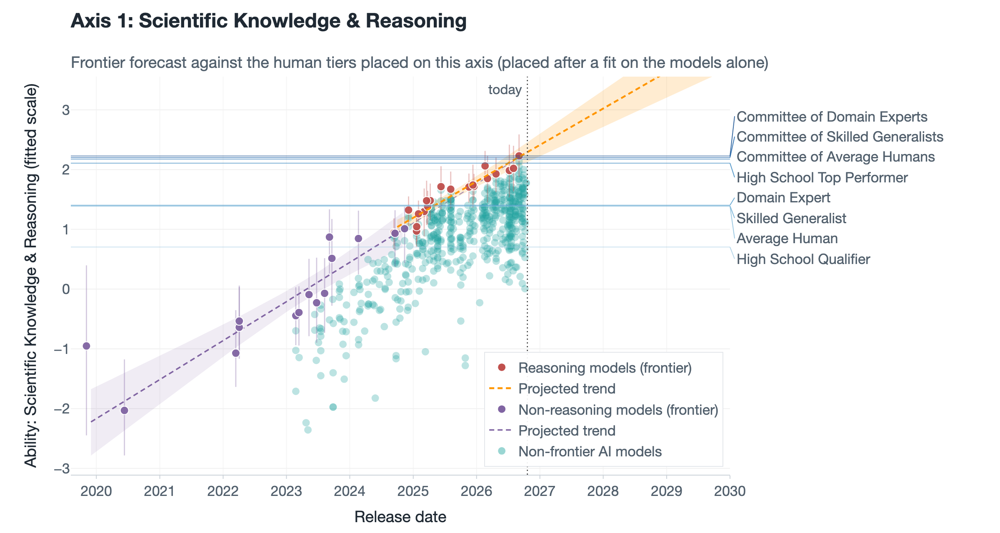
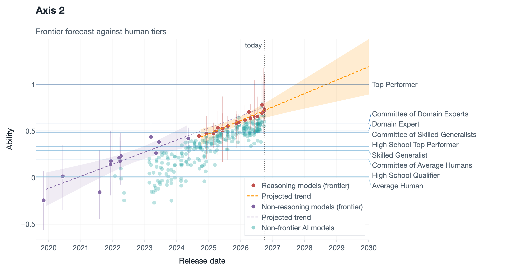
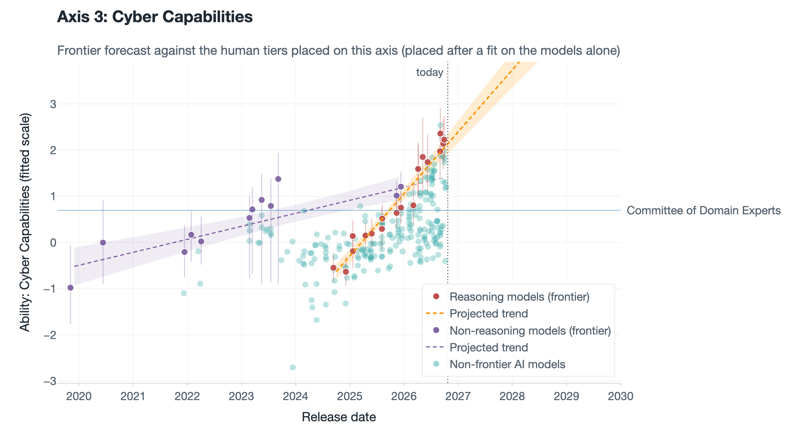
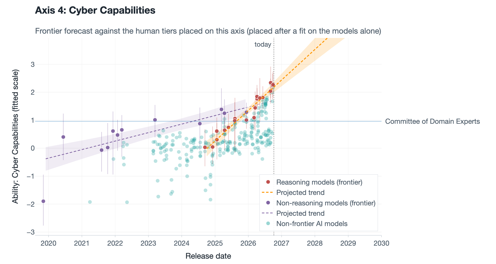
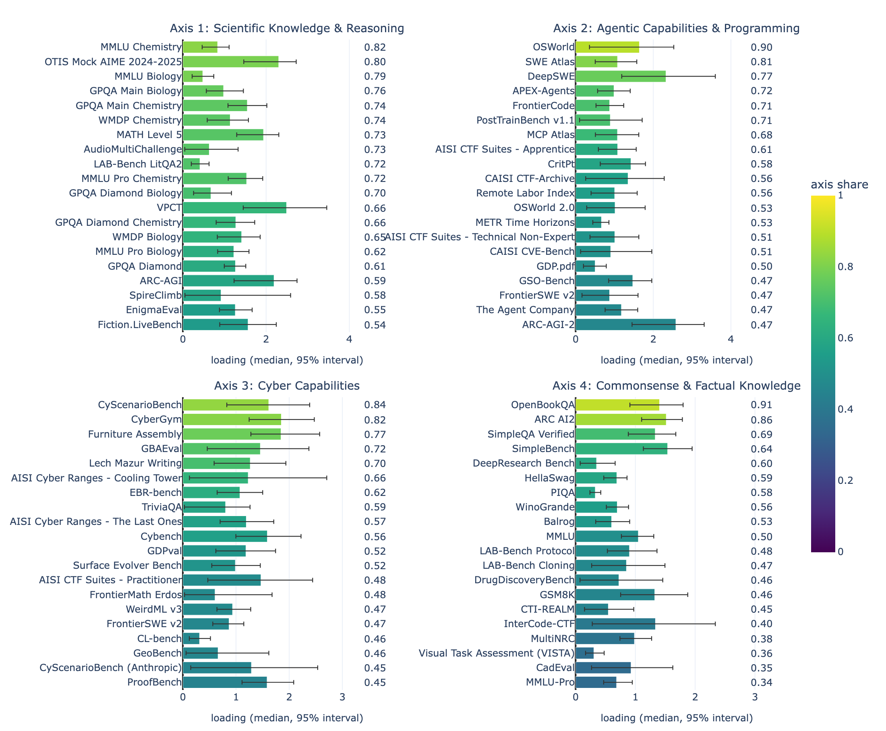

# Multi-Axis ECI

A multi-axis, Bayesian version of the **Epoch Capabilities Index** ([ECI](https://epoch.ai/eci)) with human baselines placed on its axes, and the frontier forecasts it supports.

The method was published in [*Multi-Axis Bayesian Epoch Capabilities Index with Human Baselines*](https://gpaipolicylab.org/blog-5) (GPAI Policy Lab, 2026-09-07). That post was fitted on the pre-pipeline dataset, and its code, data and results are frozen on the branch [`blogpost-frozen`](https://github.com/General-Purpose-AI-Policy-Lab/Multiaxis_ECI/tree/blogpost-frozen); its tables stay on `main` under `5_outputs/pre_pipeline/`. `main` has moved on since: the data now comes from [`benchmark-data-pipeline`](https://github.com/General-Purpose-AI-Policy-Lab/benchmark-data-pipeline), the K=4 flagship is fitted on the models alone and the human tiers are placed on its axes afterwards (2026-10-08), the forecast fits reasoning and non-reasoning models separately, and the current data generation is the pipeline run of 2026-10-01 (commit 956c91b, rebuilt 2026-10-05). This README describes `main`; where a number comes from the post, it says so.

## The idea

The ECI compresses many benchmark scores into one number per model, following the [Rosetta Stone paper](https://arxiv.org/abs/2512.00193). The previous post, [Mapping AI capabilities to human expertise on the Rosetta Stone scale](https://www.lesswrong.com/posts/cfbdyJGbHkY8rPesE/mapping-ai-capabilities-to-human-expertise-on-the-rosetta-1) (code: [`rosetta-human-baselines`](https://github.com/General-Purpose-AI-Policy-Lab/rosetta-human-baselines)), put human baseline tiers on that scale, which exposed a problem. Humans score near-perfectly on abstract-reasoning benchmarks like ARC-AGI or VPCT and near chance on GPQA-type benchmarks, while many models show the opposite pattern. No single ordering produces both.

This repository rebuilds the index in PyMC as a **K-axis compensatory 2PL Beta-MIRT**, an item-response model with a Beta likelihood. Every ability comes with its uncertainty, and the human tiers (nine at K=4: six individual tiers from the Average Human to the Top Performer, and three committees) were fitted *inside* the model as test-takers in the post. In the K=4 decomposition that joint fit let the human tiers trade one axis against another (about 5 sd below every model on one axis, 8 above on another), so the flagship is now fitted on the models alone and the tiers are placed on each axis afterwards (see [Method](#method)). The K=1 anchored index, which we call **ECI-H** (ECI with Human baselines) to keep it distinct from Epoch's published ECI, still fits them inside.

## Current results: the K=4 flagship on the 2026-10-01 build

The axes carry no names of their own. They are named by hand after the benchmarks that load most on them, in the fit folder's `axis_names.json`, and a refit keeps a name only while its signature benchmarks still define the axis (see [docs/plots.md](docs/plots.md)). The current flagship's four:

1. **Fluid Intelligence & Formal Sciences** (ARC-AGI, ARC-AGI-2, OTIS Mock AIME, with MATH Level 5, CritPt, FrontierMath)
2. **Scientific Knowledge & Reasoning** (MMLU Biology, GSM8K, GPQA Main Biology, with WMDP, MMLU-Pro biology and chemistry)
3. **Agentic Capabilities & Programming** (OSWorld, APEX-Agents, SWE Atlas, with MCP Atlas, CTI-REALM, DeepResearch Bench)
4. **Cyber Capabilities** (CyScenarioBench, CyberGym, Cybench, with ExploitBench, AISI Cyber Ranges, GBAEval)

The four axes are distinct: their largest correlation is 0.64 (axes 1 and 3). Each benchmark is assigned to the axes by the share of its loading variance, and the axes are tracked across posterior draws by the collinearity of their loading columns (see [Reading the results](#reading-the-results)).

The fit has 20 chains, and they fall into five posterior modes (see [Limitations](#limitations)). The figures, the dashboard and the forecasts read chains 2, 5, 15 and 17, the mode with the best log-density, which integrated leave-one-out also ranks first (the modes file's `selected_chains`, read by `analysis.best_mode_chains`).

Per axis, the frontier releases of reasoning models (red) and of the others (purple) each get their own fitted line; the reasoning models' line is projected to 2030 (orange, 80% band) against the human tiers (horizontal lines) placed on that axis. Abilities are on the fitted scale (the models' mean at 0 on each axis). A tier is drawn only where its own scores place it, on benchmarks that measure the axis, so the cyber and agentic axes carry few tiers: no human baseline exists for most of their benchmarks.









The 20 benchmarks with the largest share of each axis, their loadings (median and 95% interval) and that share:



`python docs/make_readme_figures.py` redraws these five figures from the current flagship trace, with the builders of the per-fit folders.

The K=4 fit sees 5,113 observations, 850 models and 98 benchmarks, and the human tiers' 56 scores are placed on it afterwards; the canonical K=1 index, which also applies the curated exclusions and fits the tiers inside, 4,091 observations on 84 benchmarks. The post's fits saw 4,923 / 829 / 96 (tiers included) and 4,184 / 781 / 88.

## Setup

Python 3.11 or later, with the pinned scientific stack (`pyproject.toml`):

```bash
uv venv --python 3.11 .venv && uv pip install -e . --group dev   # or: pip install -e .
plotly_get_chrome -y                                             # once per env; figure export needs it
python -m multiaxis_eci sync                                     # 0_input/ from ../benchmark-data-pipeline
python -m pytest -m "not slow"                                   # under a minute, about 435 tests
ruff check .
```

On macOS with the Command Line Tools for Xcode 27 or later, PyTensor's C compiles would fail on the `-ld64` flag it adds for the classic linker; importing `multiaxis_eci` installs a shim that strips the flag once the linker is seen to refuse it (`multiaxis_eci/pytensor_compat.py`, to be removed when PyTensor stops adding it).

The pins are load-bearing: arviz >= 1.0 replaces `InferenceData` with xarray's `DataTree`, and nutpie >= 0.16.8 hands a `DataTree` back from a zarr store, either of which breaks this code and the golden logp tests. `nutpie` (Rust NUTS) is the default sampler, 2-3x faster than PyMC NUTS on CPU.

## Data

The scores, release dates, organizations, countries, categories, chance floors, known ceilings, access classes and human baselines all come from [`benchmark-data-pipeline`](https://github.com/General-Purpose-AI-Policy-Lab/benchmark-data-pipeline). `python -m multiaxis_eci sync` copies the consumer views and tables of its latest run (`3_views/<YYYYMMDD>/`, `2_database/<YYYYMMDD>/`) from a checkout (the sibling directory by default, `--pipeline PATH` otherwise) into `0_input/`, and writes `provenance.json` with the pipeline commit and the run's date. The copies are tracked, so a fit is reproducible without the pipeline. Anything wrong in the data (a date, an alias, a floor, a benchmark's inclusion) is fixed in the pipeline, then synced here. **After every sync, run `python 1_curated/0_audit_sync.py`**: it lists, for each new model, benchmark and human baseline, the curated tables still to complete, the decisions to take (a benchmark entering the index, a new lineage, a human baseline) and what looks unexpected (frontier jumps, revised scores, effort inversions), in `5_outputs/<data generation>/sync_audit.md`. The full procedure across both repositories, what to check and what to decide, is in [`.claude/skills/data-refresh/SKILL.md`](.claude/skills/data-refresh/SKILL.md) (also loaded by Claude Code for any refresh). Benchmarks retired for measurement validity (FrontierMath v1, AlgoTune, MindCube) never reach `0_input/`.

Two modeling-stage filters apply at load time: the curated exclusion list below, and the drop of isolated families, every release (base model plus snapshot, all reasoning efforts and run variants together) whose observations sit on a single benchmark in the fit's scope. Such a family carries no cross-benchmark information, and the 2020-2022 tail of them fed a second posterior mode on the legacy QA series; `--keep-isolated-families` restores them.

What stays in this repository is what belongs to the model, under `1_curated/`: the "easy for humans" exclusion list of the canonical K=1 index, the reviewed lineage map and its overrides, the data-driven SOTA list, the reviewed clips of below-floor scores, the models' openness labels, the optional SimpleQA original column and Epoch's reference ECI table. See [`1_curated/README.md`](1_curated/README.md).

Every output goes under `5_outputs/<data generation>/`, named after the day the pipeline run it was fitted on happened (`config.DATA_TAG`), whatever the day of the fit: the current flagship is `5_outputs/data20261001/mirt_lineageprior_lineagebm_nohumans/`, the canonical K=1 index `5_outputs/data20261001/canonical_humanmerge/`. A fit on a newer build never overwrites an older one. `5_outputs/pre_pipeline/` holds the post's fits as they were published; the K=4 trace was deleted and is regenerated from `blogpost-frozen` (`5_outputs/pre_pipeline/mirt_humanmerge_lineageprior_lineagebm/REGENERATE.md`).

## Run

The K=4 flagship: 2,500 draws after 2,000 tuning steps on 10 chains, then 10 more chains with another seed merged in, so that more starting points explore the modes (copy the trace out of the fit folder first, as the second run writes over it):

```bash
python 3_fit/fit.py --K 4 --lineage-prior --lineage-bm --no-humans --chains 10 --seed 42
python 3_fit/fit.py --K 4 --lineage-prior --lineage-bm --no-humans --chains 10 --seed 43 \
    --merge-chains <copy of the first trace>
```

Traces on disk keep every fifth draw (`--save-thin`, `config.SAVE_THIN`): convergence and the tables are computed on the full run, and the 16,000 saved draws pin every median and interval the figures show. While a nutpie fit runs, its draws stream to a zarr store beside the trace instead of accumulating in RAM (`--stream-draws`, on by default; `--no-stream-draws` restores the in-memory run), so the machine stays usable during a ten-hour fit; the store is deleted once the thinned trace is saved.

Then find the posterior modes, place the human tiers, render the fit's figures (on the chains the deliverables read and, separately, the remaining ones when there are several modes; French versions under `fr/`, their SVG twins under `fr/svg/`), and rebuild the dashboard. The deliverables read the best mode by log-density, or the `selected_chains` of the modes file when it names a subset, checked against `4_diagnostics/integrated_loo.py` (the flagship's: chains 2, 5, 15, 17). `fit.py` writes the axis tables on every chain; `--write-tables` rewrites them on the chains the deliverables read, and `mirt_loadings.csv` among them is the frame every chain group's figures are put back on. A refit sets the old modes file aside, so a selection never outlives its chains:

```bash
python 4_diagnostics/diagnose_chains.py --trace <trace> --write-modes
python 4_diagnostics/diagnose_chains.py --trace <trace> --write-tables   # once selected_chains is final
python 4_diagnostics/diagnose_chains.py --trace <trace> --write-tables --secondary   # a secondary mode with axes of its own
python 4_diagnostics/5_place_humans.py --trace <trace>                   # a fit without humans
python 4_diagnostics/5_place_humans.py --trace <trace> --secondary       # its secondary mode, if named
python 4_diagnostics/3_plot_mirt.py --forecast --trace <trace>
python 4_diagnostics/4_build_dashboard.py --force-all
```

**The joint fit (secondary).** The former flagship, with the human tiers fitted inside under the merged order, stays in its own folder (`mirt_humanmerge_lineageprior_lineagebm/`, `analysis.JOINT_FIT`) for comparison. It is out of the default run and of the dashboard; to bring it to a new data generation:

```bash
python 3_fit/fit.py --K 4 --human-merge --lineage-prior --lineage-bm --chains 10 --seed 42
```

then the same mode, table and figure steps as above (without `5_place_humans.py`: its tiers are fitted).

The canonical K=1 index, 2,500 draws x 8 chains, writing the full ECI-H deliverables to `5_outputs/<data generation>/canonical_humanmerge/`:

```bash
python 3_fit/fit.py --preset canonical --human-merge
```

`--human-merge` is the human tier order every analysis uses (decision 2026-09-14), the committee chain included (2026-10-07): the canonical index fits it, and the flagship's placement of the tiers imposes the same order. It is deliberately not a default: no fit imposes an order on the human tiers without saying so in its folder name. The flat `--human-prior` is a sensitivity variant, and a run with neither writes to plain `canonical/`.

ECI-H is the per-draw affine transform of ability pinned at Claude 3.5 Sonnet (2024-10-22) = 130 and GPT-5 (2025-08-07, medium) = 150, matching the scale of Epoch's dashboard. Every other flag, where a fit's output lands, and the plot / diagnose / dashboard commands: [docs/cli.md](docs/cli.md).

## Layout

```
.
├── 0_input/             # step 0: the pipeline's views and tables, synced (all_scores_flat, human_baselines, models, benchmarks, manifest, provenance)
├── 1_curated/           # step 1: inputs specific to this model, and its builder scripts (SOTA list, lineage map, model openness, ...)
├── 2_model/multiaxis_eci/  # step 2: the library: config, data loading, models, analysis, figures, sync
├── 3_fit/fit.py         # step 3: the fit CLI (canonical preset + exploration)
├── 4_diagnostics/       # step 4: post-fit tools, the numbered four in reproduction order
├── 5_outputs/           # step 5: everything a fit writes, one folder per data generation (data<YYYYMMDD>/), then per fit: tables, trace, figures/; pre_pipeline/ holds the post's fits, open_closed_frontier/ and us_cn_frontier/ the open-weights vs closed and US vs Chinese frontier notes
├── 6_writeups/          # step 6: the post's figure scripts (6_writeups/blogpost/), the dashboard's card registry
├── archive/             # kept for the record, not maintained: notebooks (one-off investigations), results_old (superseded fits)
├── docs/                # model math, CLI reference, figure catalogue, the README's figures (figures/, make_readme_figures.py)
├── tests/               # fast unit tests + golden logp locks
└── index.html           # the dashboard of the current fits (tracked, served as is)
```

Numbered entries are the reproduction path, in order: inputs, curation, model, fit, diagnostics, outputs, write-ups. Everything else is a reference. Inside `1_curated/` and `4_diagnostics/` the same rule applies.

Full model math, priors and identification: [docs/model_math.md](docs/model_math.md). Figures and how to read them: [docs/plots.md](docs/plots.md). What each post-fit script does: [4_diagnostics/README.md](4_diagnostics/README.md). What each notebook investigated: [archive/notebooks/README.md](archive/notebooks/README.md).

## Method

Each test-taker *m* has K abilities θ forming a skill profile, the way a student can be strong in algebra and weak in essay writing. Each benchmark weighs those skills through K non-negative loadings *A*, which also set how sharply it separates test-takers, what psychometrics calls discrimination. Difficulty *D* is the bar the weighted skills must clear, and a chance floor *c*, fixed per benchmark and never estimated, starts the curve where guessing does:

<p align="center"><em>µ = c<sub>b</sub> + (1 − c<sub>b</sub>) σ( Σ<sub>k</sub> A<sub>b,k</sub> θ<sub>m,k</sub> − D<sub>b</sub> )</em>,  &nbsp; <em>p ~ Beta(µφ<sub>b</sub>, (1−µ)φ<sub>b</sub>)</em>,  &nbsp; observed <em>y N<sub>b</sub> ~ Binomial(N<sub>b</sub>, p)</em></p>

Most scores are a share of a benchmark's N<sub>b</sub> items, so they enter as y N<sub>b</sub> successes of a Beta-binomial: item sampling sets a noise floor no benchmark can fall below, and a score of 0 or 1 is an ordinary outcome. The 23 benchmarks whose score is not a share of items (correlations, areas, rubric fractions, dependent steps of one scenario) keep the Beta density y ~ Beta(µφ<sub>b</sub>, (1−µ)φ<sub>b</sub>), their exact zeros at 0.005. N<sub>b</sub> and that split are in `1_curated/benchmark_n_items.csv`. A Beta on every score was the likelihood until 2026-10-01, when one axis of the K=4 fit captured Chess Puzzles, its noise collapsed to almost nothing and six of eight chains froze in that spike.

This is the *compensatory* family: a strong skill can make up for a weak one inside the sum. A soft-minimum link nests it (`--link semicomp`: the weighted mean of the abilities becomes a soft minimum whose sharpness β is learned; β → 0 gives back the sum). On the models it learns β ≈ 0.8 yet predicts held-out scores no better (2026-10-07), and fixing a hard minimum (`noncomp`) predicts them worse; the earlier product-link and interaction models live in `multiaxis_eci/fits/`. The derivations and the tests are in [docs/model_math.md](docs/model_math.md).

**The data is sparse.** The test-taker by benchmark matrix is filled at about 6%, and the average test-taker has six scores. Many arrangements of abilities and loadings explain those scores equally well, so unconstrained runs land on different solutions. Ordering priors identify the fit:

- `--lineage-prior --lineage-bm` add a **soft** prior along each vendor's release chain. A release is nudged above its predecessor, more over a longer gap, but can regress if the data says so. Thinking-effort variants attach to their base release and are not ordered among themselves.
- `--human-merge` sets a **hard** partial order on the human tiers when they are fitted (the canonical index, and the placement below). A Domain Expert is at least as good as a Skilled Generalist, a committee at least as good as its members, on every axis. It says nothing about the size of the gaps, and leaves genuinely incomparable tiers unordered.

On the post's data, where the tiers were inside the K=4 fit, both were needed: runs without priors split into two sets of axes, the human ordering alone left them in disagreement, and both together brought them into agreement; on leave-one-out cross-validation that model beat the no-prior version by about 107 ± 18 and the 1D index by about 1,000 ± 33. On the 2026-09-08 build, dropping the lineage prior leaves the eight chains on eight separate solutions, hundreds of nats apart (the README of that fit, `5_outputs/data20260908/mirt_humanmerge/README.md`, deleted with the 2026-09-08 outputs on 2026-10-01, stays in the git history); with both priors the chains still fall into several modes (see [Limitations](#limitations)).

On by default with no flag over them: non-negative loadings, the Beta-binomial likelihood and the effort means (a release's effort levels as one learned direction); the K-axis fits also apply the fixed-c chance floors (the pipeline's `lower_bound`) and hierarchical benchmark noise, which the canonical index leaves out. In the canonical K=1 index, a release's effort variants also share one level, as in the lineage prior but without the links between releases, so a variant scored on one benchmark only sits near its release. Each has an opt-out documented in [docs/cli.md](docs/cli.md).

**Placing the human tiers** (`4_diagnostics/5_place_humans.py`, `analysis.human_placement`). Fitted with the models, the 56 human scores are too few to pin the tiers on four axes, and the compensatory sum let them sit about 5 sd below every model on one axis and 8 above on another. No prior on the tiers, extra human axis or less compensatory link fixed that (docs/model_math.md), so the flagship leaves them out and places them afterwards, one axis at a time, with the benchmark side frozen at the selected chains' medians:

- a benchmark measures the axis that carries the largest share of its loading variance, and its human scores count there only if its content fits the axis's name (`1_curated/human_axis_content.csv`, judged pair by pair: Furniture Assembly is dropped from the cyber axis, a plausible link such as InterCode-CTF on scientific knowledge is enough to keep one);
- on those benchmarks a tier's score follows the fit's own likelihood, its other axes set to those of a typical model at the same ability (a linear regression over the models), and the tiers keep the ordered prior above (`config.HUMAN_ORDER_MERGED`);
- a tier is drawn where it has a score of its own below the ceiling, or sits between two tiers that do; each placement is checked against the scores it rests on and the first model that reached each score (`human_placement.json`).

**The forecast** starts from the models evaluated on an axis, keeps one effort per family (the best) and one release per organization and day, and splits them into reasoning models and the others. Each regime's frontier (the running top two by release date) gets one straight line, fitted on the posterior medians and weighted by their posterior SD; the reasoning line is projected from the first reasoning release to 2030, and crossing dates read the piecewise frontier against each human tier. The full rule: [docs/plots.md](docs/plots.md).

## Reading the results

**Axes have no fixed names, so they are labelled after sampling.** Swapping two axes leaves every prediction unchanged, because the swap moves the loadings `A` and the abilities `theta` together and only their product reaches the likelihood. Each draw picks its own labels, and they are fixed afterwards by collinearity: every draw's axes are permuted so that their loading columns line up with a common reference (an axis is recognised by which benchmarks load on it), and the axes are then numbered from the strongest. Until 2026-10-06 each draw was sorted by strength instead, which mixed the axes once their strengths came within a few percent of each other, as the four of the current flagship do.

Whether the chains agree on those axes is a different question, with its own number. Each chain's mean loading columns are matched to the pooled mean over every permutation and sign (all 24 of them at K=4), and the median correlation is reported per axis. Nothing is relabelled by this; the number says which axis the chains disagree about, which the identified r-hat cannot. Convergence is judged on identified quantities only (`eta`, `D`, `sigma_b`), because raw per-axis r-hat on `A` and `theta` is permutation-inflated.

**An ability is trustworthy only where it was measured.** A test-taker's ability on an axis rests on benchmarks that load on that axis. Models from 2021-2023 took only easy benchmarks, so their hard-axis ability is extrapolated, and can land high with a wide interval. Figures and forecasts use a model on an axis only where its own scores cover that axis (`candidate_mask`: the axis shares of the benchmarks it was run on sum to at least 1); the fit and the diagnostics keep every row.

## Limitations

- **The K=4 posterior is multimodal.** Its 20 chains (2,500 draws after 2,000 tuning steps each; 10 with seed 42, then 10 with seed 43, merged with `fit.py --merge-chains`) fall into five modes, the largest holding 8 chains but 35 nats below the best (4 chains); a second mode of 4 chains sits 9 nats below it with a different split of the agentic, cyber and knowledge benchmarks. The modes are not an extra axis but discrete ways, under non-negative loadings, of carving the same space.
- **Choosing the mode.** PSIS-LOO cannot rank the modes: a large share of the observations get a Pareto k above 0.7. Integrating each score's own latent block out (`4_diagnostics/integrated_loo.py`, after Vehtari et al. 2016) ranks the chain groups at equal draws: the best mode by log-density first, the second at −3 ± 3, the largest at −13 ± 7, the two others near −31, on the observations reliable everywhere. The deliverables read the first. Stacking the modes' predictions (Yao, Vehtari and Gelman 2022) would weigh three of them and gain about 50 nats, a sign that each mode explains part of the data the others miss.
- **Few human scores per axis.** The tiers rest on the scores of the benchmarks that measure each axis: 13 on fluid intelligence, 17 on scientific knowledge, 2 on the agentic axis (OSWorld, The Agent Company) and 1 on cyber (Cybench). Where a tier has several scores they can disagree beyond what any one ability explains (the Skilled Generalist at 0.40 on MATH Level 5 but 0.98 on ARC-AGI; the Domain Expert above every model on GPQA Main Chemistry and below most on WMDP), and a crossing date read on the trend can differ from the date the frontier first reached a score on the benchmark itself (Cybench 0.75: May 2024 on the trend, November 2025 on the benchmark).
- **The unordered canonical index splits.** Without the human tier order (a sensitivity fit), the 2026-10-01 data let some chains settle in a second mode where MMLU, ARC (AI2) and GSM8K go flat and the Average Human rises above most tiers; it holds about e^-14 of the posterior mass. The ordered index every analysis reads converges.
- **Data.** We need more of it and of better quality, especially for the human baselines. The 6% fill rate is what forced the extra assumptions above.
- **Benchmark-level scores.** We fit those rather than item-level answers, so the MIRT assumptions are not fully respected. The Rosetta Stone paper and the ECI have the same problem.
- **Calibration.** The predictive intervals come out wider than the data requires (leave-one-out PIT variance 0.067 at K=4 against 0.083 for a calibrated model), which makes the model somewhat more conservative than it should be.

## Resources

- Epoch Capabilities Index: <https://epoch.ai/eci>
- Rosetta Stone paper: <https://arxiv.org/abs/2512.00193>
- Alexander Barry's Bayesian ECI, which this rebuild follows: [Kicking the tires of the Epoch Capabilities Index](https://abstatisticalconsulting.substack.com/p/kicking-the-tires-of-the-epoch-capabilities-741)
- Epoch on benchmark scores carrying more than one dimension: [Benchmark Scores = General Capability + Claudiness](https://epoch.ai/gradient-updates/benchmark-scores-general-capability-claudiness)
- Epoch on the jump that came with reasoning models: [Have AI Capabilities Accelerated?](https://epoch.ai/publications/have-ai-capabilities-accelerated) (Denain and Barry, 2026)

## Authors

This project is co-authored by:

- [Yassine Essifi](https://github.com/linkofrivia), former Research Resident, GPAI Policy Lab
- [Jérémy Andréoletti](https://github.com/Jeremy-Andreoletti), Head of Research, GPAI Policy Lab

## License

CC-BY-4.0 ([LICENSE](LICENSE)) over the code, the analysis layer, `1_curated/` and `5_outputs/`.

The upstream benchmark scores carry their own terms. Epoch AI is CC-BY and requires attribution, RAND is cited under RR-A3797-1, and Scale SEAL has no open license. What to credit when republishing: [NOTICE.md](NOTICE.md).
